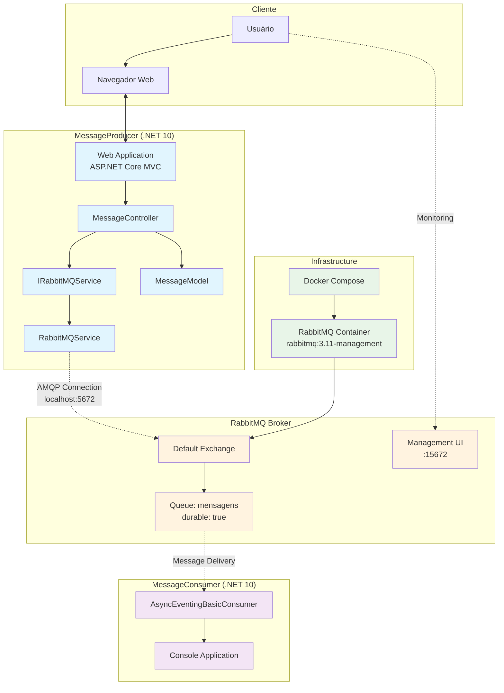
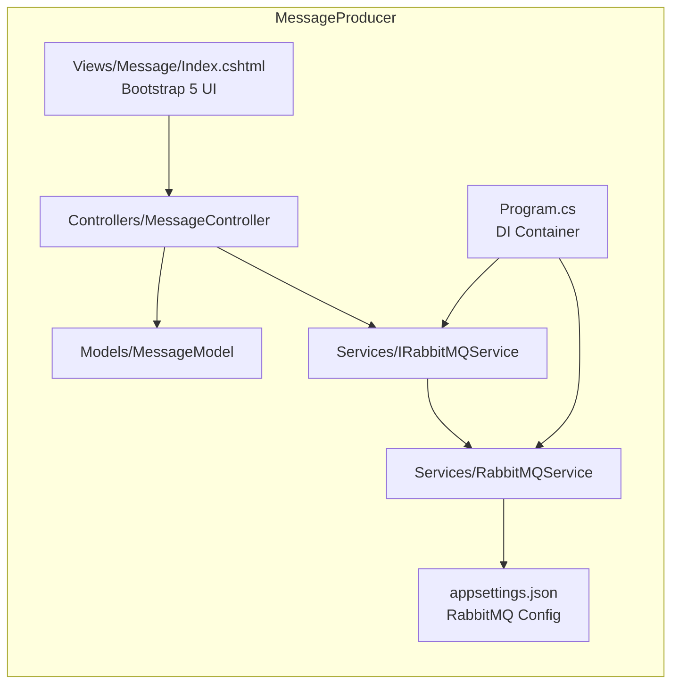
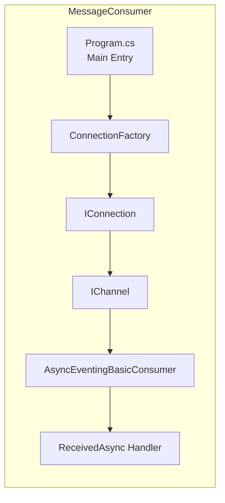
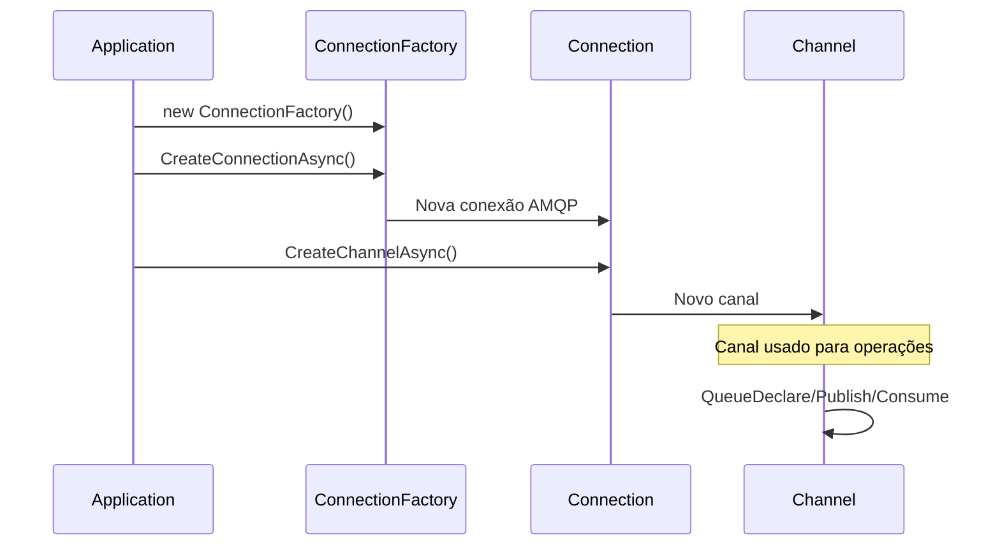
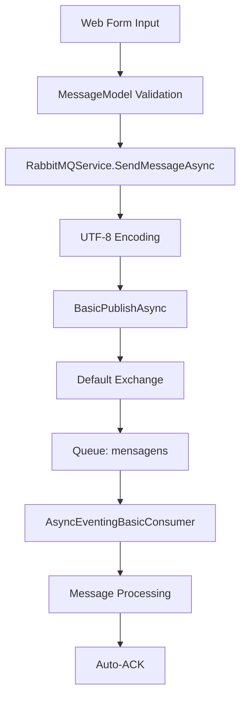

# Diagrama de Arquitetura 




## Componentes Detalhados

### MessageProducer (Port: 5000)



### MessageConsumer



### RabbitMQ Topology

```mermaid
graph TB
    subgraph "RabbitMQ Broker"
        EX[Default Exchange<br/>Type: Direct<br/>Name: ""]
        Q[Queue: mensagens<br/>Durable: true<br/>Exclusive: false<br/>Auto-delete: false]
        B[Binding<br/>Routing Key: "mensagens"]
    end
    
    PROD[MessageProducer] -.->|publish| EX
    EX --> B
    B --> Q
    Q -.->|consume| CONS[MessageConsumer]
    
    classDef exchange fill:#ffd54f
    classDef queue fill:#81c784
    classDef binding fill:#ffb74d
    
    class EX exchange
    class Q queue
    class B binding
```

## Padrões de Messaging Implementados

### 1. Work Queue Pattern
- **Tipo**: Point-to-Point
- **Descrição**: Uma fila de trabalho onde mensagens são distribuídas entre consumers
- **Uso**: Processamento assíncrono de tarefas

### 2. Connection Management


### 3. Message Flow


## Configurações Técnicas

### Connection Settings
```json
{
  "RabbitMQ": {
    "HostName": "localhost",
    "UserName": "admin", 
    "Password": "admin123",
    "QueueName": "mensagens",
    "Port": 5672,
    "VirtualHost": "/"
  }
}
```

### Queue Declaration Parameters
```csharp
await channel.QueueDeclareAsync(
    queue: "mensagens",        // Nome da fila
    durable: true,             // Persiste restarts
    exclusive: false,          // Compartilhada
    autoDelete: false,         // Não auto-remove
    arguments: null            // Sem argumentos extras
);
```

### Consumer Configuration
```csharp
await channel.BasicConsumeAsync(
    queue: "mensagens",        // Fila a consumir
    autoAck: true,             // ACK automático
    consumer: asyncConsumer    // Handler assíncrono
);
```

## Métricas e Monitoramento

### Endpoints Disponíveis
- **Producer Web**: http://localhost:5000
- **RabbitMQ Management**: http://localhost:15672
- **Docker Health**: `docker ps` para status dos containers

### Logs
- **Producer**: Logs do ASP.NET Core
- **Consumer**: Console output com timestamps
- **RabbitMQ**: Container logs via `docker logs`

