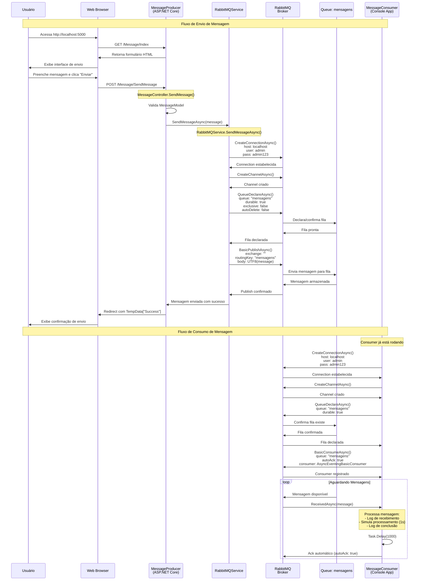

# Diagrama de Sequência - RabbitMQ Demo

## Fluxo Completo de Mensagens

## Detalhes Técnicos

### Configurações do RabbitMQ

| Componente | Configuração | Valor |
|------------|--------------|-------|
| **Host** | HostName | localhost |
| **Porta** | Port | 5672 (AMQP) |
| **Management** | Management UI | 15672 |
| **Usuário** | UserName | admin |
| **Senha** | Password | admin123 |
| **Virtual Host** | VHost | / (default) |

### Configurações da Fila

| Propriedade | Valor | Descrição |
|-------------|-------|-----------|
| **Nome** | mensagens | Nome da fila |
| **Durable** | true | Fila persiste após restart do broker |
| **Exclusive** | false | Fila pode ser acessada por múltiplas conexões |
| **Auto-Delete** | false | Fila não é deletada automaticamente |
| **Exchange** | "" (default) | Usa o exchange padrão |
| **Routing Key** | mensagens | Mesma do nome da fila |

### Padrão de Messaging

- **Padrão**: Work Queue (Point-to-Point)
- **Exchange Type**: Direct (default)
- **Delivery Mode**: Persistent (durable queue)
- **Acknowledgment**: Auto-ACK
- **Prefetch**: Não configurado (default)

### Fluxo de Dados

1. **Serialização**: UTF-8 encoding
2. **Formato da Mensagem**: `[timestamp] texto_da_mensagem`
3. **Timestamp**: `yyyy-MM-dd HH:mm:ss`
4. **Processamento**: Assíncrono com delay simulado

