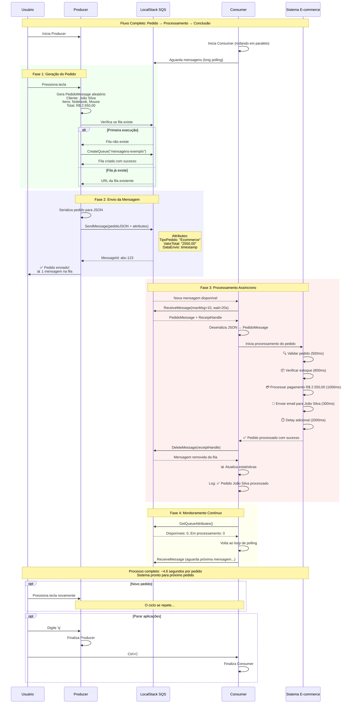

# Diagrama de Sequência - Fluxo Completo

Este diagrama mostra o fluxo end-to-end completo, desde a geração de um pedido no Producer até o processamento final no Consumer, passando pelo SQS como middleware de mensageria.

## Visão Geral do Fluxo

O exemplo simula um sistema de e-commerce real com as seguintes fases:

1. **🏭 Geração**: Producer cria pedidos fictícios com dados realistas
2. **📤 Envio**: Mensagens são enviadas para fila SQS com metadados
3. **⚡ Processamento**: Consumer processa pedidos de forma assíncrona
4. **🎯 Conclusão**: Mensagens processadas são removidas da fila

## Componentes do Sistema

### 🏭 Producer
- **Função**: Simula um frontend/API que recebe pedidos
- **Tecnologia**: Aplicação Console .NET 10
- **Características**: Interface interativa, geração de dados aleatórios realistas

### 📨 LocalStack SQS  
- **Função**: Middleware de mensageria (simula Amazon SQS)
- **Tecnologia**: Contêiner Docker LocalStack
- **Características**: Persistência local, APIs compatíveis com AWS

### 📦 Consumer
- **Função**: Simula sistema de processamento de pedidos
- **Tecnologia**: Aplicação Console .NET 10  
- **Características**: Processamento assíncrono, tratamento de erros

### 🎯 Sistema E-commerce
- **Função**: Lógica de negócio para processamento de pedidos
- **Implementação**: Simulação com delays realistas
- **Etapas**: Validação → Estoque → Pagamento → Notificação

## Características Técnicas

### Performance
- **Long Polling**: Reduz latência e número de requests desnecessários
- **Batch Processing**: Processa até 10 mensagens simultaneamente
- **Processamento Assíncrono**: ~4.6 segundos por pedido

### Confiabilidade
- **At-Least-Once Delivery**: SQS garante entrega das mensagens
- **Visibility Timeout**: Previne processamento duplicado
- **Error Handling**: Mensagens com falha permanecem para retry

### Observabilidade
- **Logs Estruturados**: Informações detalhadas de cada etapa
- **Métricas**: Contadores de mensagens e estatísticas da fila
- **Cores no Console**: Facilita identificação visual de status
