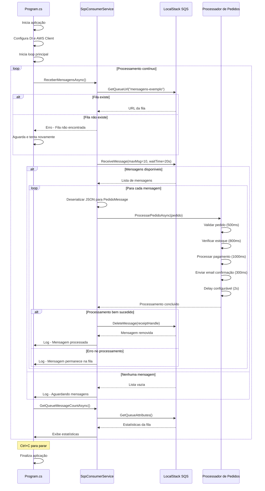

# Diagrama de Sequência - Consumer

Este diagrama mostra o fluxo de execução do Consumer, desde a inicialização até o processamento contínuo de mensagens do SQS.

## Fluxo Principal

1. **Inicialização**: Configuração do Dependency Injection e cliente AWS
2. **Loop Principal**: Processamento contínuo de mensagens
3. **Recepção**: Uso de long polling para receber mensagens eficientemente
4. **Processamento**: Simulação completa do fluxo de um pedido de e-commerce
5. **Limpeza**: Remoção de mensagens processadas com sucesso
6. **Tratamento de Erros**: Mensagens com erro permanecem na fila para reprocessamento

## Componentes

- **Program.cs**: Ponto de entrada e loop principal de processamento
- **SqsConsumerService**: Serviço responsável pela comunicação com SQS
- **LocalStack SQS**: Simulador local do Amazon SQS
- **Processador de Pedidos**: Lógica de negócio para processar pedidos

## Características Técnicas

- **Long Polling**: Aguarda até 20 segundos por mensagens para reduzir chamadas desnecessárias
- **Batch Processing**: Processa até 10 mensagens por vez
- **Tratamento de Erros**: Mensagens com falha permanecem na fila para retry automático
- **Processamento Assíncrono**: Simula operações reais de um sistema de e-commerce
