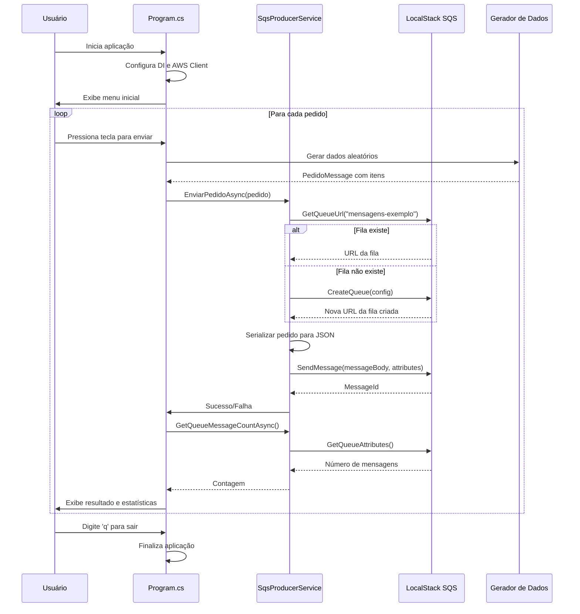

# Diagrama de Sequência - Producer

Este diagrama mostra o fluxo de execução do Producer, desde o início da aplicação até o envio de mensagens para o SQS.

## Fluxo Principal

1. **Inicialização**: Configuração do Dependency Injection e cliente AWS
2. **Geração de Dados**: Criação de pedidos aleatórios com dados fictícios
3. **Verificação da Fila**: Busca pela fila ou criação automática se não existir
4. **Envio da Mensagem**: Serialização e envio do pedido para o SQS
5. **Estatísticas**: Consulta do número de mensagens na fila
6. **Interface**: Exibição de resultados e controle do usuário

## Componentes

- **Usuário**: Interage com a aplicação via console
- **Program.cs**: Ponto de entrada e orquestração principal
- **SqsProducerService**: Serviço responsável pela comunicação com SQS
- **LocalStack SQS**: Simulador local do Amazon SQS
- **Gerador de Dados**: Lógica para criar pedidos fictícios realistas
