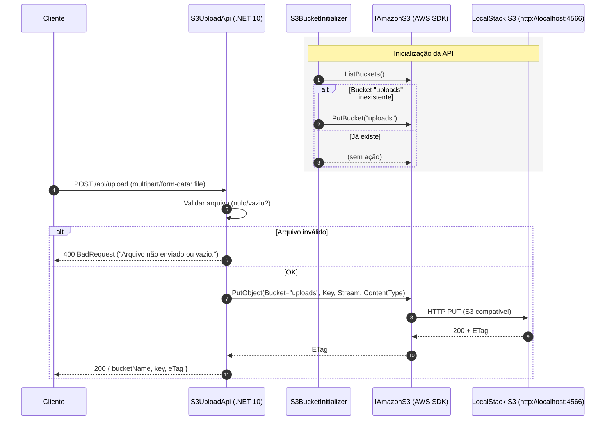

# Documentação

## Diagrama de Sequência – Fluxo de Upload (LocalStack)

### Observações
- O bucket padrão é `uploads` (configurável em `appsettings.Development.json` → `AwsS3`).
- A URL e o `ForcePathStyle=true` apontam para a LocalStack (porta 4566).
- O endpoint de upload é `POST /api/upload` aceitando `multipart/form-data` com campo `file`.

