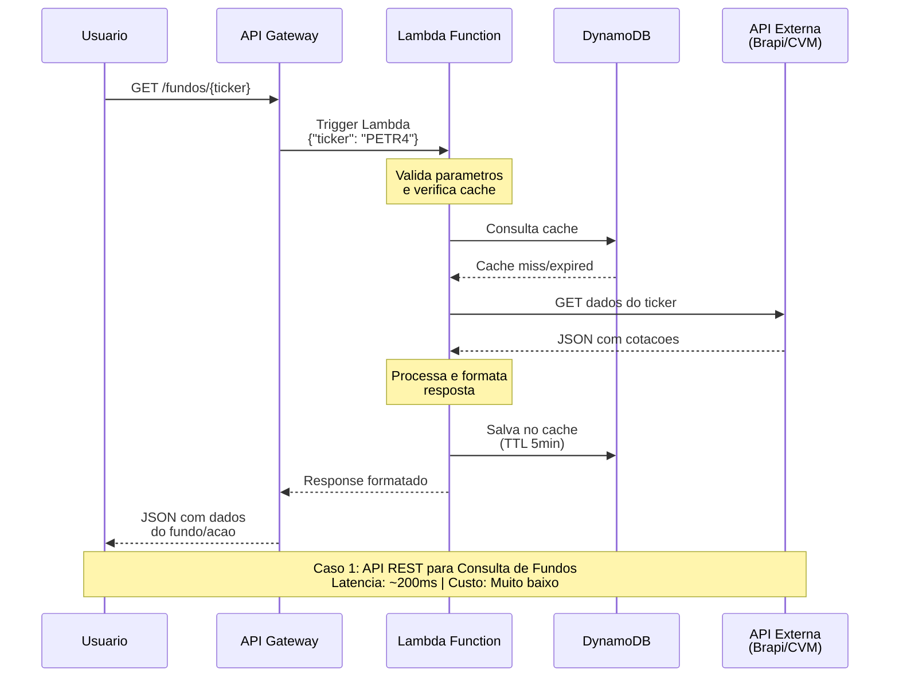

# Caso 1: API REST para Consulta de Fundos

## 📝 Descrição
API REST que consulta informações de fundos de investimento e ações em tempo real, utilizando cache inteligente para otimizar performance e reduzir custos.

## 🎯 Caso de Uso Real
- **App mobile** de investimentos
- **Dashboard** web de corretoras
- **Integração B2B** entre sistemas financeiros
- **Chatbots** de atendimento ao cliente

## 🔄 Diagrama de Sequência



## ⚡ Características Técnicas

### Performance
- **Latência**: 150-300ms
- **Cold Start**: ~200ms (primeira execução)
- **Warm Start**: ~10-20ms (execuções subsequentes)
- **Cache Hit**: ~50ms

### Escalabilidade
- **Concurrent executions**: Até 10.000 simultâneas
- **Auto-scaling**: Baseado na demanda
- **Rate limiting**: 10.000 req/s por API Gateway

### Custos (estimativa mensal)
- **100K requests**: ~$0.20 Lambda + $3.50 API Gateway = **$3.70/mês**
- **1M requests**: ~$2.00 Lambda + $35 API Gateway = **$37/mês**
- **DynamoDB**: ~$1-5/mês (dependendo do volume)

## 🛠️ Implementação

### Estrutura da Lambda
```csharp
public class FundosHandler 
{
    private readonly HttpClient httpClient;
    private readonly DynamoDBClient dynamoClient;
    
    public async Task<APIGatewayProxyResponse> HandleRequest(
        APIGatewayProxyRequest request, 
        ILambdaContext context)
    {
        // 1. Validar ticker
        // 2. Verificar cache no DynamoDB
        // 3. Se cache miss, consultar API externa
        // 4. Salvar no cache com TTL
        // 5. Retornar resposta formatada
    }
}
```

### Configurações Recomendadas
- **Memory**: 256MB (otimizado custo/performance)
- **Timeout**: 30 segundos
- **Environment Variables**:
  - `CACHE_TTL_MINUTES=5`
  - `BRAPI_BASE_URL=https://brapi.dev/api`
  - `DYNAMO_TABLE_NAME=fundos-cache`

## 📊 Monitoramento

### CloudWatch Metrics
- **Duration**: Tempo de execução
- **Invocations**: Número de chamadas
- **Errors**: Taxa de erro
- **Throttles**: Execuções limitadas

### Alertas Importantes
- Latência > 1000ms
- Taxa de erro > 1%
- Cache hit rate < 80%

## 🔍 Vantagens

✅ **Custo baixo** - Paga apenas pelo uso
✅ **Zero servidor** para manter
✅ **Auto-scaling** automático
✅ **Cache inteligente** reduz API calls
✅ **Monitoramento** nativo da AWS

## ⚠️ Limitações

❌ **Cold start** pode impactar UX
❌ **Timeout máximo** de 15 minutos
❌ **Dependência** de APIs externas
❌ **Vendor lock-in** com AWS

## 🚀 Melhorias Possíveis

1. **Provisioned Concurrency** - Eliminar cold starts
2. **ElastiCache** - Cache distribuído mais rápido
3. **Step Functions** - Orquestração de múltiplas consultas
4. **CloudFront** - CDN para respostas estáticas
