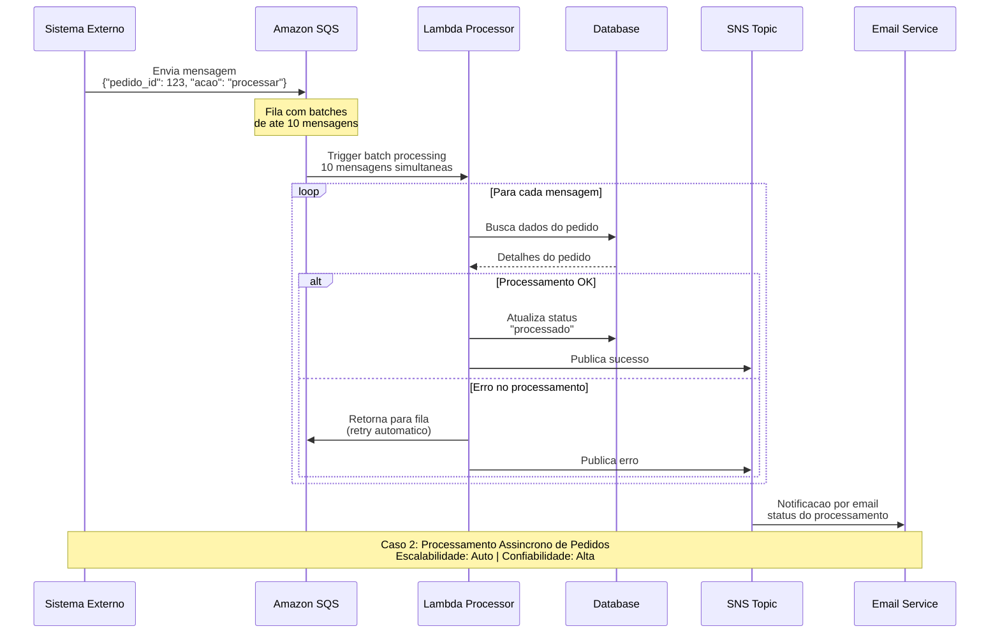

# Caso 2: Processamento Assíncrono de Pedidos

## 📝 Descrição
Sistema de processamento em lote para pedidos de investimento, utilizando filas SQS para garantir alta disponibilidade e processamento confiável.

## 🎯 Caso de Uso Real
- **Processamento de ordens** de compra/venda
- **Importação de dados** de sistemas legados
- **Processamento de pagamentos** em lote
- **Geração de relatórios** complexos
- **Integração com sistemas terceiros**

## 🔄 Diagrama de Sequência



## ⚡ Características Técnicas

### Performance
- **Throughput**: Até 300.000 mensagens/segundo (Standard Queue)
- **Batch Size**: 1-10 mensagens por invocação Lambda
- **Retry Policy**: 3 tentativas com backoff exponencial
- **Dead Letter Queue**: Para mensagens não processadas

### Disponibilidade
- **SLA**: 99.9% (SQS) + 99.95% (Lambda)
- **Multi-AZ**: Replicação automática
- **Durabilidade**: 99.999999999% (11 9's)

### Custos (estimativa mensal)
- **1M mensagens SQS**: $0.40
- **1M execuções Lambda**: $0.20
- **SNS notifications**: $0.50
- **Total**: **~$1.10/mês** por milhão de pedidos

## 🛠️ Implementação

### Estrutura da Lambda
```csharp
public class PedidosProcessor
{
    public async Task<SQSBatchResponse> HandleRequest(
        SQSEvent sqsEvent, 
        ILambdaContext context)
    {
        var batchResponse = new SQSBatchResponse();
        
        foreach(var record in sqsEvent.Records)
        {
            try 
            {
                var pedido = JsonSerializer.Deserialize<Pedido>(record.Body);
                await ProcessarPedido(pedido);
                
                // Sucesso - mensagem será removida da fila
            }
            catch(Exception ex)
            {
                // Falha - adiciona à resposta para retry
                batchResponse.BatchItemFailures.Add(new SQSBatchResponse.BatchItemFailure
                {
                    ItemIdentifier = record.MessageId
                });
                
                await PublicarErro(ex, pedido);
            }
        }
        
        return batchResponse;
    }
}
```

### Configuração SQS
```json
{
    "VisibilityTimeout": 300,
    "MessageRetentionPeriod": 1209600,
    "MaxReceiveCount": 3,
    "RedrivePolicy": {
        "deadLetterTargetArn": "arn:aws:sqs:us-east-1:123456789012:pedidos-dlq",
        "maxReceiveCount": 3
    }
}
```

### Configurações Lambda
- **Memory**: 512MB-1GB (dependendo da complexidade)
- **Timeout**: 5-15 minutos
- **Batch Size**: 10 mensagens
- **Concurrent Executions**: 100-1000

## 📊 Padrões de Uso

### 1. High Throughput (Alto Volume)
- **Cenário**: 1M+ pedidos/dia
- **Config**: Batch size 10, memory 1GB
- **Custo**: ~$30/mês

### 2. Low Latency (Baixa Latência)  
- **Cenário**: Processamento em tempo real
- **Config**: Batch size 1, provisioned concurrency
- **Custo**: ~$100/mês

### 3. Batch Processing (Lote Noturno)
- **Cenário**: Processamento em horários específicos
- **Config**: EventBridge + SQS
- **Custo**: ~$5/mês

## 🔍 Vantagens

✅ **Desacoplamento** entre sistemas
✅ **Confiabilidade** com retry automático
✅ **Escalabilidade** horizontal automática
✅ **Monitoramento** detalhado
✅ **Custo efetivo** para alto volume
✅ **Dead Letter Queue** para debugging

## ⚠️ Limitações

❌ **Latência mínima** de ~1-2 segundos
❌ **Ordem das mensagens** não garantida (Standard Queue)
❌ **Timeout** máximo de 15 minutos por execução
❌ **Duplicate processing** possível

## 📈 Monitoramento Essencial

### CloudWatch Metrics
- `ApproximateNumberOfMessages` (SQS)
- `Duration` e `Errors` (Lambda)
- `NumberOfMessagesSent` (SNS)

### Alertas Críticos
- Mensagens na DLQ > 10
- Taxa de erro Lambda > 5%
- Fila principal > 1000 mensagens

## 🚀 Casos Reais de Sucesso

### Fintech Brasileira
- **Volume**: 2M transações/dia
- **Economia**: 60% vs EC2
- **Disponibilidade**: 99.98%

### E-commerce
- **Pedidos**: 500K/dia
- **Processamento**: 15s média
- **Custo**: $80/mês

### Sistema Bancário
- **PIX/TED**: 1M operações/dia
- **Latência**: 2-5s
- **Compliance**: Auditoria completa
