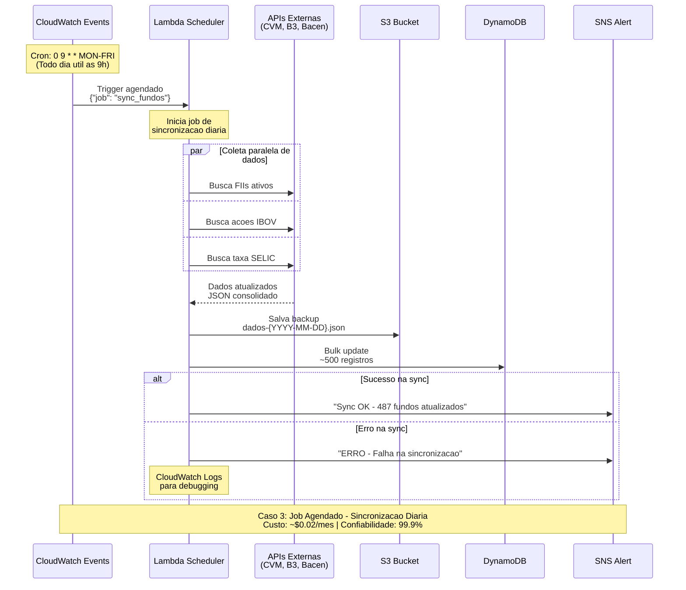

# Caso 3: Job Agendado - Sincronização Diária

## 📝 Descrição
Sistema automatizado que executa diariamente para sincronizar dados de mercado financeiro, coletando informações de múltiplas APIs e armazenando em banco de dados e S3.

## 🎯 Caso de Uso Real
- **Atualização de preços** de fundos e ações
- **Coleta de indicadores** econômicos (SELIC, CDI, IPCA)
- **Backup automatizado** de dados críticos
- **Relatórios financeiros** mensais/anuais
- **Sincronização com sistemas** externos (ERP, CRM)

## 🔄 Diagrama de Sequência



## ⚡ Características Técnicas

### Agendamento
- **CloudWatch Events**: Cron expressions avançadas
- **Timezone**: UTC (considerar fuso horário brasileiro)
- **Frequência**: Diária, semanal, mensal
- **Skip weekends**: Apenas dias úteis

### Performance
- **Duração típica**: 2-10 minutos
- **Dados processados**: 500-5000 registros
- **APIs consultadas**: 3-10 endpoints
- **Paralelização**: Consultas simultâneas

### Custos (estimativa mensal)
- **Execução diária**: 30 execuções × $0.0000002 = **$0.000006**
- **CloudWatch Events**: 30 triggers = **$0.00**
- **S3 Storage**: 1GB dados = **$0.023**
- **SNS**: 60 mensagens = **$0.0006**
- **Total**: **~$0.024/mês** (2 centavos!)

## 🛠️ Implementação

### Estrutura da Lambda
```csharp
public class SyncScheduler
{
    public async Task<string> HandleRequest(
        ScheduledEvent scheduledEvent, 
        ILambdaContext context)
    {
        try
        {
            context.Logger.LogLine($"Iniciando sync: {DateTime.Now}");
            
            // 1. Parallel data collection
            var tasks = new List<Task>
            {
                ColetarFIIs(),
                ColetarAcoes(),
                ColetarIndicadores()
            };
            
            await Task.WhenAll(tasks);
            
            // 2. Consolidate and backup
            var dados = ConsolidarDados();
            await SalvarBackupS3(dados);
            
            // 3. Bulk update database  
            await AtualizarDatabase(dados);
            
            // 4. Success notification
            await NotificarSucesso(dados.Count);
            
            return $"Sync completo: {dados.Count} registros";
        }
        catch(Exception ex)
        {
            await NotificarErro(ex);
            throw;
        }
    }
}
```

### Configuração CloudWatch Events
```json
{
    "ScheduleExpression": "cron(0 9 ? * MON-FRI *)",
    "Description": "Sync diario de dados financeiros - dias uteis 9h",
    "State": "ENABLED",
    "Targets": [
        {
            "Id": "1",
            "Arn": "arn:aws:lambda:us-east-1:123456789012:function:sync-financeiro",
            "Input": "{\"job_type\": \"daily_sync\", \"timestamp\": \"${aws.events.scheduled-time}\"}"
        }
    ]
}
```

### Configurações Lambda
- **Memory**: 1GB (para processamento paralelo)
- **Timeout**: 15 minutos
- **Environment Variables**:
  - `SYNC_BUCKET=financeiro-backups`
  - `DB_TABLE=dados-financeiros`
  - `SNS_TOPIC_ARN=arn:aws:sns:us-east-1:123:alerts`

## 📅 Padrões de Agendamento

### 1. Diário - Dados de Mercado
```
cron(0 9 ? * MON-FRI *)  # 9h, dias úteis
cron(0 18 * * * *)       # 18h, todos os dias
```

### 2. Semanal - Relatórios
```
cron(0 6 ? * SUN *)      # Domingo 6h
cron(0 23 ? * FRI *)     # Sexta 23h
```

### 3. Mensal - Fechamento
```
cron(0 2 1 * ? *)        # 1º dia do mês, 2h
cron(0 1 L * ? *)        # Último dia do mês, 1h
```

## 📊 Casos de Uso por Setor

### Fintech
- **Atualização de preços**: 2x/dia
- **Indicadores econômicos**: 1x/dia
- **Backup**: 1x/dia
- **Custo**: $1-5/mês

### Corretora
- **Sincronização B3**: 3x/dia
- **Fundos de investimento**: 1x/dia
- **Relatórios CVM**: 1x/mês
- **Custo**: $5-20/mês

### Banco
- **Taxas interbancárias**: 4x/dia
- **Câmbio**: A cada 15min (horário comercial)
- **Backup regulatório**: 1x/dia
- **Custo**: $20-100/mês

## 🔍 Vantagens

✅ **Custo ultra baixo** (~$0.02/mês)
✅ **Zero manutenção** de servidores
✅ **Confiabilidade alta** (99.9%+)
✅ **Paralelização** nativa
✅ **Monitoramento** automático
✅ **Notificações** de status
✅ **Backup automático** em S3

## ⚠️ Considerações

❌ **Timezone** - CloudWatch usa UTC
❌ **Retry manual** em caso de falha
❌ **Cold start** de ~1-2s
❌ **Debugging** via CloudWatch Logs apenas

## 📈 Monitoramento

### CloudWatch Metrics Essenciais
- **Invocations**: Execuções bem-sucedidas
- **Duration**: Tempo total de processamento  
- **Errors**: Taxa de falha
- **Throttles**: Execuções limitadas

### Alertas Recomendados
```json
{
    "Duration > 10min": "Processamento muito lento",
    "Errors > 0": "Falha na sincronização",
    "No invocation in 25h": "Job não executou"
}
```

## 🚀 Melhorias Avançadas

### 1. Step Functions
Para jobs complexos com múltiplas etapas:
```json
{
    "Comment": "Sync workflow",
    "StartAt": "ColetarDados",
    "States": {
        "ColetarDados": {"Type": "Parallel", "Branches": [...]},
        "ProcessarDados": {"Type": "Task"},
        "SalvarResultados": {"Type": "Task"}
    }
}
```

### 2. Conditional Execution
Executar apenas se necessário:
```csharp
// Só sync se houve mudanças
var lastUpdate = await GetLastUpdateTime();
if (DateTime.Now - lastUpdate < TimeSpan.FromHours(6))
    return "Sync desnecessario";
```

### 3. Multi-Region Backup
```csharp
await Task.WhenAll(
    SalvarS3("us-east-1"),
    SalvarS3("us-west-2")  // Backup geografico
);
```
