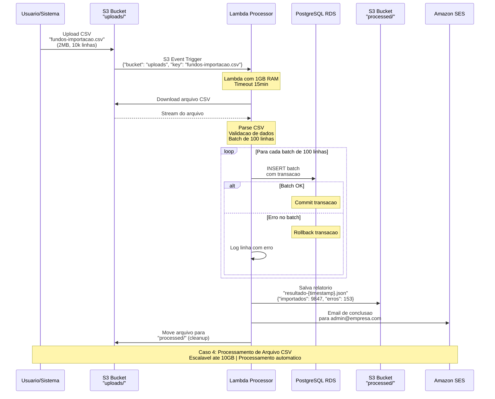

# Caso 4: Processamento de Arquivo CSV

## 📝 Descrição
Sistema automatizado que processa arquivos CSV enviados para S3, realizando validação, transformação e importação em banco de dados, com notificações de resultado via email.

## 🎯 Caso de Uso Real
- **Importação de dados** financeiros (extratos, movimentações)
- **Upload de carteira** de investimentos
- **Processamento de relatórios** regulatórios
- **Migração de dados** entre sistemas
- **Conciliação bancária** automatizada

## 🔄 Diagrama de Sequência



## ⚡ Características Técnicas

### Capacidade de Processamento
- **Tamanho máximo**: 10GB por arquivo
- **Linhas**: Até 10 milhões de registros
- **Throughput**: ~1000-5000 linhas/segundo
- **Memory**: 512MB - 3GB (conforme arquivo)

### Tipos de Arquivo Suportados
- **CSV**: Delimitado por vírgula/ponto-e-vírgula
- **TSV**: Tab-separated values
- **Fixed-width**: Campos de tamanho fixo
- **Excel**: .xlsx via biblioteca

### Custos (estimativa)
- **Arquivo 1MB (5K linhas)**: $0.001
- **Arquivo 100MB (500K linhas)**: $0.10
- **Arquivo 1GB (5M linhas)**: $1.00
- **Storage S3**: $0.023/GB/mês

## 🛠️ Implementação

### Estrutura da Lambda
```csharp
public class CsvProcessor
{
    public async Task<string> HandleRequest(
        S3Event s3Event, 
        ILambdaContext context)
    {
        foreach(var record in s3Event.Records)
        {
            var bucket = record.S3.Bucket.Name;
            var key = record.S3.Object.Key;
            
            context.Logger.LogLine($"Processando: {bucket}/{key}");
            
            var resultado = await ProcessarArquivo(bucket, key, context);
            
            await SalvarRelatorio(resultado);
            await EnviarEmailResultado(resultado);
            await MoverArquivoProcessado(bucket, key);
            
            return JsonSerializer.Serialize(resultado);
        }
        
        return "Processamento concluído";
    }
    
    private async Task<ResultadoProcessamento> ProcessarArquivo(
        string bucket, string key, ILambdaContext context)
    {
        var resultado = new ResultadoProcessamento 
        { 
            Arquivo = key, 
            InicioProcessamento = DateTime.Now 
        };
        
        using var stream = await s3Client.GetObjectStreamAsync(bucket, key);
        using var reader = new StreamReader(stream);
        using var csv = new CsvReader(reader, CultureInfo.InvariantCulture);
        
        var batch = new List<RegistroFinanceiro>();
        var batchSize = 100;
        
        await csv.ReadAsync();
        csv.ReadHeader();
        
        while (await csv.ReadAsync())
        {
            try
            {
                var registro = csv.GetRecord<RegistroFinanceiro>();
                
                // Validação dos dados
                if (ValidarRegistro(registro))
                {
                    batch.Add(registro);
                    
                    // Processa batch quando atingir o tamanho
                    if (batch.Count >= batchSize)
                    {
                        await ProcessarBatch(batch);
                        resultado.Importados += batch.Count;
                        batch.Clear();
                        
                        // Log de progresso
                        context.Logger.LogLine($"Processadas {resultado.Importados} linhas...");
                    }
                }
                else
                {
                    resultado.Erros.Add($"Linha {csv.Context.Parser.Row}: Dados inválidos");
                }
            }
            catch(Exception ex)
            {
                resultado.Erros.Add($"Linha {csv.Context.Parser.Row}: {ex.Message}");
            }
        }
        
        // Processa batch final
        if (batch.Count > 0)
        {
            await ProcessarBatch(batch);
            resultado.Importados += batch.Count;
        }
        
        resultado.FimProcessamento = DateTime.Now;
        resultado.TempoTotal = resultado.FimProcessamento - resultado.InicioProcessamento;
        
        return resultado;
    }
}
```

### Configuração S3 Event
```json
{
    "Rules": [
        {
            "Name": "ProcessarCsvUpload", 
            "Filter": {
                "Key": {
                    "FilterRules": [
                        {"Name": "prefix", "Value": "uploads/"},
                        {"Name": "suffix", "Value": ".csv"}
                    ]
                }
            },
            "Status": "Enabled",
            "Configuration": {
                "LambdaConfiguration": {
                    "LambdaFunctionArn": "arn:aws:lambda:us-east-1:123456789012:function:csv-processor"
                }
            }
        }
    ]
}
```

### Configurações Lambda
- **Memory**: 1-3GB (baseado no tamanho do arquivo)
- **Timeout**: 15 minutos
- **Environment Variables**:
  - `DB_CONNECTION_STRING`
  - `BATCH_SIZE=100`
  - `EMAIL_FROM=noreply@empresa.com`
  - `EMAIL_TO=admin@empresa.com`

## 📋 Validações Implementadas

### Validação de Estrutura
```csharp
private bool ValidarRegistro(RegistroFinanceiro registro)
{
    var erros = new List<string>();
    
    // CNPJ válido
    if (!CnpjValido(registro.CNPJ))
        erros.Add("CNPJ inválido");
        
    // Valor positivo
    if (registro.Valor <= 0)
        erros.Add("Valor deve ser positivo");
        
    // Data válida
    if (registro.Data > DateTime.Now)
        erros.Add("Data futura não permitida");
        
    // Código do fundo existe
    if (!await ExisteFundo(registro.CodigoFundo))
        erros.Add("Fundo não cadastrado");
    
    return erros.Count == 0;
}
```

### Transformações de Dados
```csharp
private RegistroFinanceiro TransformarRegistro(dynamic csvRow)
{
    return new RegistroFinanceiro
    {
        CNPJ = LimparCnpj(csvRow.CNPJ),
        Valor = decimal.Parse(csvRow.Valor.Replace("R$", "").Replace(",", ".")),
        Data = DateTime.ParseExact(csvRow.Data, "dd/MM/yyyy", null),
        CodigoFundo = csvRow.CodigoFundo.ToUpper().Trim()
    };
}
```

## 📊 Casos de Uso por Setor

### Gestora de Fundos
- **Arquivos**: Movimentações diárias (5-50MB)
- **Frequência**: 2-3 uploads/dia
- **Volume**: 10-100K registros/dia
- **Custo**: $20-50/mês

### Corretora de Valores
- **Arquivos**: Extratos de clientes (1-500MB)
- **Frequência**: Sob demanda
- **Volume**: 100K-5M registros
- **Custo**: $50-200/mês

### Banco
- **Arquivos**: Conciliação bancária (100MB-2GB)
- **Frequência**: Diária
- **Volume**: 1-10M transações
- **Custo**: $100-500/mês

## 🔍 Vantagens

✅ **Processamento automático** ao fazer upload
✅ **Escalabilidade** para arquivos grandes
✅ **Transações** garantem consistência
✅ **Relatórios detalhados** de erro
✅ **Email de notificação** automática
✅ **Backup** dos arquivos processados
✅ **Custo baixo** por processamento

## ⚠️ Limitações

❌ **Timeout máximo** 15 minutos
❌ **Memory máxima** 10GB
❌ **Arquivos muito grandes** precisam de Step Functions
❌ **Cold start** pode atrasar processamento

## 📈 Monitoramento

### CloudWatch Metrics
- **Duration**: Tempo de processamento
- **Memory Usage**: Pico de memória utilizada
- **Errors**: Falhas no processamento
- **S3 Events**: Uploads detectados

### Alertas Importantes
- Processamento > 10 minutos
- Taxa de erro > 5%
- Memory usage > 90%
- Arquivos não processados > 10min

## 🚀 Otimizações Avançadas

### 1. Step Functions para Arquivos Grandes
```json
{
    "Comment": "Processamento de arquivo grande",
    "StartAt": "SplitFile",
    "States": {
        "SplitFile": {
            "Type": "Task",
            "Resource": "arn:aws:lambda:function:split-csv"
        },
        "ProcessChunks": {
            "Type": "Parallel",
            "Branches": [
                {"StartAt": "ProcessChunk1"},
                {"StartAt": "ProcessChunk2"},
                {"StartAt": "ProcessChunk3"}
            ]
        },
        "ConsolidateResults": {
            "Type": "Task", 
            "Resource": "arn:aws:lambda:function:consolidate-results"
        }
    }
}
```

### 2. Streaming com Kinesis
Para processamento em tempo real:
```csharp
// Upload dispara Kinesis Data Firehose
// Processa linha por linha em Lambda
// Menor latência, maior throughput
```

### 3. Provisioned Concurrency
Para eliminar cold starts:
```json
{
    "ProvisionedConcurrency": 5,
    "ReservedConcurrency": 100
}
```

## 📝 Template de Email
```html
<h2>Processamento de Arquivo Concluído</h2>
<p><strong>Arquivo:</strong> {{arquivo}}</p>
<p><strong>Registros importados:</strong> {{importados}}</p>
<p><strong>Erros encontrados:</strong> {{erros.length}}</p>
<p><strong>Tempo total:</strong> {{tempo_total}}</p>

{{#if erros.length}}
<h3>Detalhes dos Erros:</h3>
<ul>
{{#each erros}}
    <li>{{this}}</li>
{{/each}}
</ul>
{{/if}}

<p>Relatório completo disponível em: 
<a href="{{relatorio_url}}">{{relatorio_url}}</a></p>
```
