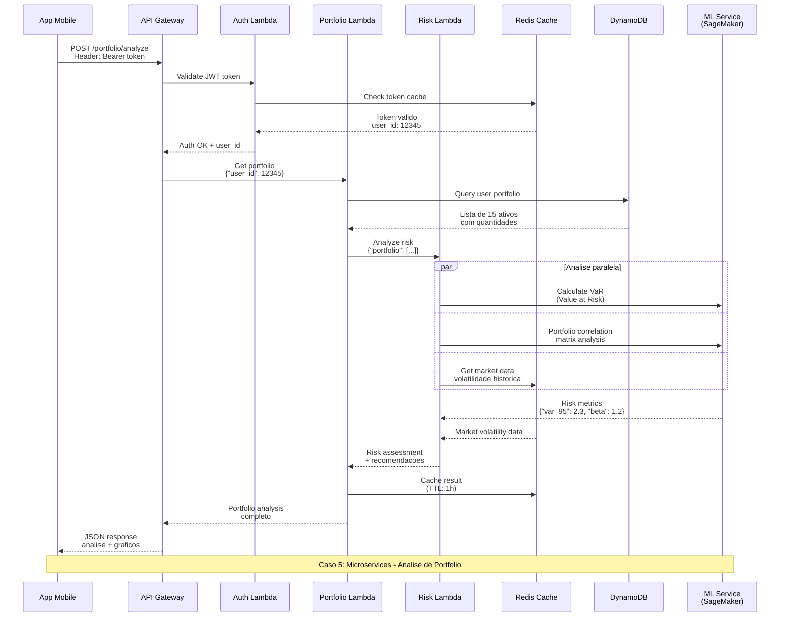

# Caso 5: Microservices - Análise de Portfólio

## 📝 Descrição
Arquitetura de microserviços para análise completa de portfólio de investimentos, utilizando múltiplas Lambdas especializadas, cache distribuído e integração com Machine Learning.

## 🎯 Caso de Uso Real
- **Robo-advisors** de investimento
- **Plataformas de wealth management**
- **Dashboards de risco** para gestores
- **APIs B2B** para fintechs
- **Relatórios regulatórios** automatizados

## 🔄 Diagrama de Sequência



## 🏗️ Arquitetura de Microserviços

### 1. Auth Lambda (Autenticação)
```csharp
public class AuthService
{
    public async Task<AuthResponse> ValidateToken(string token)
    {
        // 1. Verificar assinatura JWT
        // 2. Validar expiração
        // 3. Consultar cache Redis
        // 4. Retornar dados do usuário
    }
}
```

### 2. Portfolio Lambda (Gestão de Carteira)
```csharp
public class PortfolioService  
{
    public async Task<Portfolio> GetUserPortfolio(int userId)
    {
        // 1. Buscar posições no DynamoDB
        // 2. Enriquecer com preços atuais
        // 3. Calcular performance
        // 4. Agrupar por classe de ativo
    }
}
```

### 3. Risk Lambda (Análise de Risco)
```csharp
public class RiskAnalysisService
{
    public async Task<RiskMetrics> AnalyzePortfolio(Portfolio portfolio)
    {
        // 1. Calcular VaR (Value at Risk)
        // 2. Análise de correlação entre ativos
        // 3. Stress testing
        // 4. Recomendações de rebalanceamento
    }
}
```

## ⚡ Características Técnicas

### Performance
- **Latência total**: 300-700ms
- **Auth Lambda**: ~50ms (cache hit)
- **Portfolio Lambda**: ~150ms
- **Risk Lambda**: ~400ms (com ML)
- **Cache hit rate**: 85-95%

### Escalabilidade
- **Concurrent users**: 10.000+
- **Requests/second**: 1.000/s por Lambda
- **Auto-scaling**: Baseado em demanda
- **Regional**: Multi-AZ deployment

### Custos (estimativa mensal)
- **100K análises**: ~$25/mês
- **1M análises**: ~$200/mês
- **Redis Cache**: ~$50/mês
- **SageMaker**: ~$100-500/mês
- **Total para 1M req**: **~$350-750/mês**

## 🛠️ Implementação Detalhada

### API Gateway Configuration
```yaml
openapi: 3.0.1
info:
  title: Portfolio Analysis API
paths:
  /portfolio/analyze:
    post:
      security:
        - BearerAuth: []
      x-amazon-apigateway-integration:
        type: aws_proxy
        httpMethod: POST
        uri: arn:aws:apigateway:region:lambda:path/2015-03-31/functions/arn:aws:lambda:region:account:function:portfolio-lambda/invocations
```

### Lambda Environment Variables
```json
{
  "Auth Lambda": {
    "JWT_SECRET": "{{ssm:/portfolio/jwt-secret}}",
    "REDIS_ENDPOINT": "portfolio-cache.abc123.cache.amazonaws.com",
    "TOKEN_TTL": "3600"
  },
  "Portfolio Lambda": {
    "DYNAMO_TABLE": "user-portfolios", 
    "CACHE_ENDPOINT": "portfolio-cache.abc123.cache.amazonaws.com",
    "RISK_LAMBDA_ARN": "arn:aws:lambda:us-east-1:123:function:risk-analysis"
  },
  "Risk Lambda": {
    "SAGEMAKER_ENDPOINT": "portfolio-risk-model-endpoint",
    "CACHE_ENDPOINT": "portfolio-cache.abc123.cache.amazonaws.com",
    "VaR_CONFIDENCE": "0.95"
  }
}
```

## 📊 Dados Processados

### Portfolio Data Structure
```json
{
  "user_id": 12345,
  "portfolio": {
    "total_value": 150000.00,
    "positions": [
      {
        "asset_code": "PETR4",
        "asset_type": "stock", 
        "quantity": 1000,
        "avg_price": 28.50,
        "current_price": 32.10,
        "market_value": 32100.00,
        "weight": 21.4,
        "pnl": 3600.00
      }
    ],
    "allocation": {
      "stocks": 60.5,
      "fiis": 25.2, 
      "fixed_income": 14.3
    }
  }
}
```

### Risk Analysis Output
```json
{
  "risk_metrics": {
    "var_95_1day": 2850.00,
    "var_95_30day": 15200.00,
    "beta": 1.23,
    "sharpe_ratio": 1.45,
    "volatility_30d": 18.5,
    "correlation_matrix": [[1.0, 0.65], [0.65, 1.0]],
    "concentration_risk": "MEDIUM",
    "sector_exposure": {
      "financial": 35.2,
      "energy": 28.1,
      "real_estate": 25.2,
      "others": 11.5
    }
  },
  "recommendations": [
    {
      "type": "REBALANCE",
      "description": "Reduzir exposição ao setor financeiro",
      "suggested_action": "Vender 15% das posições em bancos",
      "impact": "Redução de 2.1% no VaR"
    }
  ]
}
```

## 🔍 Padrões de Integração

### 1. Service Mesh Pattern
```csharp
public class ServiceProxy
{
    public async Task<T> CallService<T>(string serviceName, object request)
    {
        // 1. Service discovery
        // 2. Circuit breaker
        // 3. Retry policy
        // 4. Logging/tracing
        return await httpClient.PostAsync<T>(endpoint, request);
    }
}
```

### 2. Event-Driven Communication
```csharp
// Portfolio updates trigger risk recalculation
await eventBridge.PutEventsAsync(new PutEventsRequest
{
    Entries = new List<PutEventsRequestEntry>
    {
        new PutEventsRequestEntry
        {
            Source = "portfolio.service",
            DetailType = "Portfolio Updated",
            Detail = JsonSerializer.Serialize(portfolioUpdate)
        }
    }
});
```

### 3. CQRS Pattern
```csharp
// Command: Update portfolio
public class UpdatePortfolioCommand { }

// Query: Get portfolio analysis  
public class GetPortfolioAnalysisQuery { }

// Separate read/write models
```

## 📈 Casos de Uso por Perfil

### Fintech B2C
- **Usuários**: 100K ativos
- **Análises/mês**: 2M
- **Custo**: $500/mês
- **Features**: Dashboard, alertas

### Wealth Management B2B
- **Clientes**: 50 gestoras
- **Análises/mês**: 5M
- **Custo**: $1.200/mês  
- **Features**: API, relatórios customizados

### Banco Digital
- **Usuários**: 1M+ clientes
- **Análises/mês**: 20M
- **Custo**: $4.000/mês
- **Features**: Integração mobile, robo-advisor

## 🔍 Vantagens dos Microservices

✅ **Desenvolvimento independente** por equipe
✅ **Deploy isolado** sem impacto em outros serviços
✅ **Escalabilidade granular** por função
✅ **Tecnologias diferentes** por serviço
✅ **Fault isolation** - falha não afeta todo sistema
✅ **Observabilidade detalhada** por componente

## ⚠️ Desafios dos Microservices

❌ **Complexidade de orquestração**
❌ **Latência de rede** entre serviços
❌ **Consistency** entre dados
❌ **Debugging distribuído**
❌ **Cold starts** múltiplos

## 🎯 Monitoramento Avançado

### X-Ray Tracing
```csharp
[LambdaSerializer(typeof(DefaultLambdaJsonSerializer))]
[Tracing]
public async Task<APIGatewayProxyResponse> HandleRequest(
    APIGatewayProxyRequest request, 
    ILambdaContext context)
{
    using var segment = AWSXRayRecorder.Instance.BeginSubsegment("portfolio-analysis");
    
    // Business logic with automatic tracing
    
    return response;
}
```

### CloudWatch Dashboards
```json
{
    "widgets": [
        {
            "type": "metric",
            "properties": {
                "metrics": [
                    ["AWS/Lambda", "Duration", "FunctionName", "auth-lambda"],
                    [".", ".", ".", "portfolio-lambda"],
                    [".", ".", ".", "risk-lambda"]
                ],
                "period": 300,
                "stat": "Average"
            }
        }
    ]
}
```

## 🚀 Evolução da Arquitetura

### Phase 1: Monolito → Microservices
- Separar responsabilidades
- Implementar service discovery
- Adicionar cache distribuído

### Phase 2: Event-Driven  
- EventBridge para comunicação assíncrona
- CQRS para read/write separation
- Stream processing para real-time

### Phase 3: Serverless First
- Step Functions para workflows
- AppSync para GraphQL
- Aurora Serverless para database
