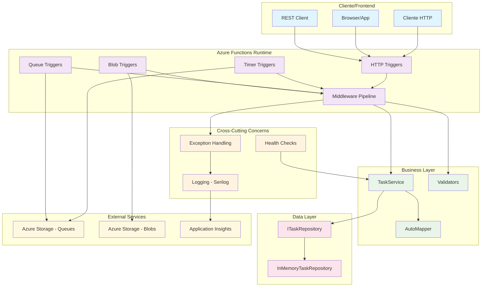
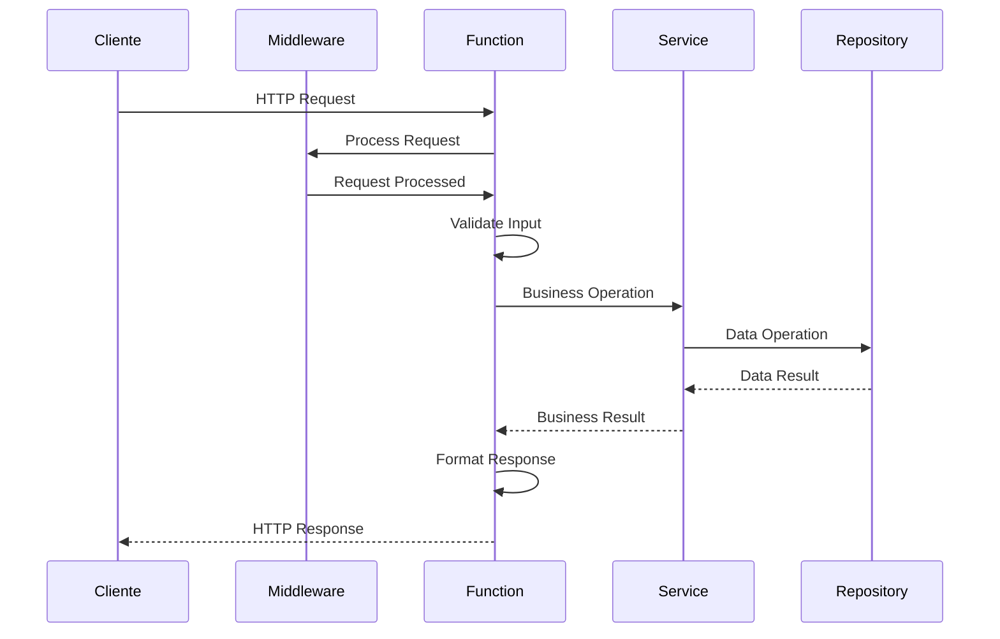
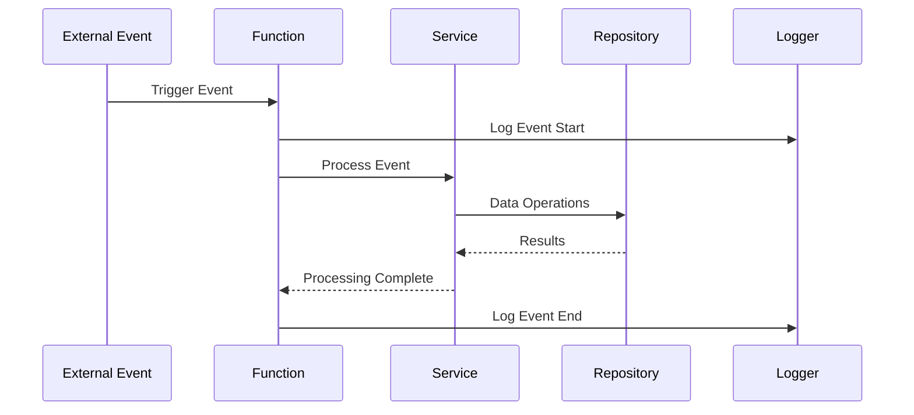
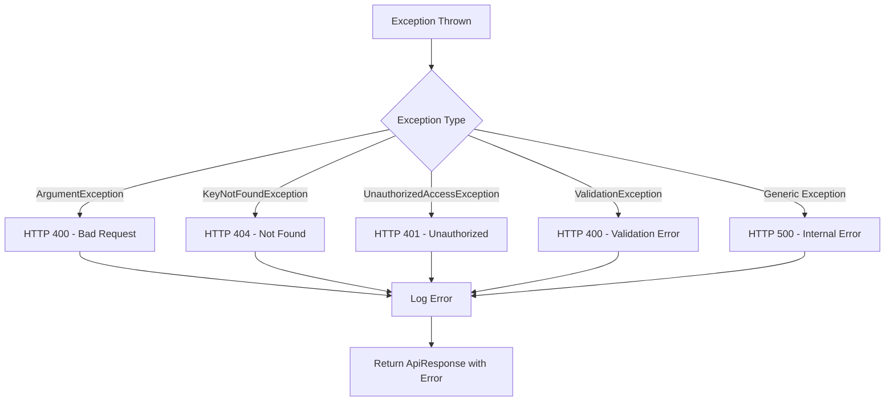
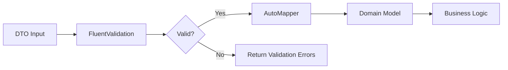
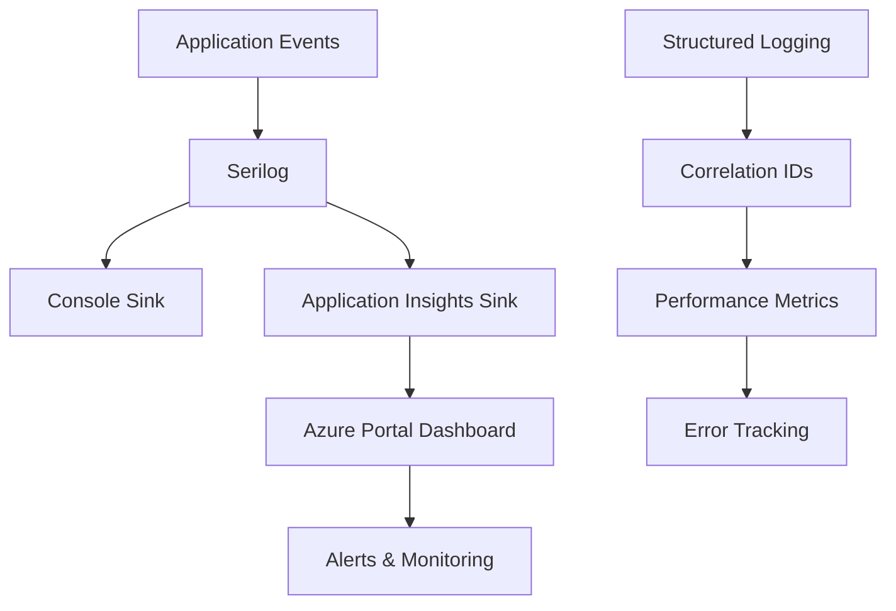

# Visão Geral da Arquitetura - Sistema de Gestão de Tarefas

## Arquitetura Geral

O sistema implementa uma arquitetura serverless usando Azure Functions com .NET 8, seguindo princípios de Clean Architecture e padrões de design modernos.



## Componentes Principais

### 1. Azure Functions (Presentation Layer)

#### HTTP Triggers - API REST
- **TaskFunctions**: CRUD completo para gerenciamento de tarefas
- **HealthCheckFunction**: Monitoramento e diagnóstico do sistema

#### Event-Driven Functions
- **TimerFunctions**: Processamento agendado (limpeza, relatórios)
- **QueueFunctions**: Processamento assíncrono de mensagens
- **BlobFunctions**: Processamento de arquivos e anexos

### 2. Business Layer

#### Services
- **TaskService**: Lógica de negócio centralizada
- **Validators**: Validação de entrada com FluentValidation
- **AutoMapper**: Mapeamento entre modelos e DTOs

#### Models & DTOs
- **TaskModel**: Entidade principal do domínio
- **DTOs**: Objetos de transferência de dados
- **ApiResponse**: Wrapper padronizado para respostas

### 3. Data Layer

#### Repository Pattern
- **ITaskRepository**: Contrato de acesso a dados
- **InMemoryTaskRepository**: Implementação em memória

### 4. Cross-Cutting Concerns

#### Middleware
- **ExceptionHandlingMiddleware**: Tratamento global de exceções

#### Logging & Monitoring
- **Serilog**: Logging estruturado
- **Application Insights**: Telemetria e monitoramento
- **Health Checks**: Verificação de integridade do sistema

## Fluxo de Dados

### Request/Response Flow (HTTP)



### Event-Driven Flow



## Padrões de Design Implementados

### 1. Repository Pattern
- Abstração da camada de dados
- Facilita testes e mudanças de persistência
- Interface única para operações CRUD

### 2. Dependency Injection
- Inversão de controle e dependência
- Facilita testes unitários
- Configuração centralizada no Program.cs

### 3. Clean Architecture
- Separação clara de responsabilidades
- Dependências apontam "para dentro"
- Facilita manutenção e evolução

### 4. CQRS Simplificado
- Separação entre comandos e consultas
- DTOs específicos para cada operação
- Validação personalizada por cenário

### 5. Chain of Responsibility (Middleware)
- Pipeline de processamento configurável
- Tratamento transversal de concerns
- Facilita adição de novos middlewares

## Configuração e Inicialização

### Program.cs - Startup Configuration

```csharp
var host = new HostBuilder()
    .ConfigureFunctionsWorkerDefaults(builder => {
        builder.UseMiddleware<ExceptionHandlingMiddleware>();
    })
    .ConfigureServices(services => {
        // Dependências de negócio
        services.AddSingleton<ITaskRepository, InMemoryTaskRepository>();
        services.AddScoped<ITaskService, TaskService>();
        
        // AutoMapper e Validação
        services.AddAutoMapper(typeof(TaskMappingProfile));
        services.AddValidatorsFromAssemblyContaining<CreateTaskDtoValidator>();
        
        // Logging e Monitoramento
        services.AddApplicationInsightsTelemetryWorkerService();
        services.AddLogging(builder => builder.AddSerilog(logger));
    })
    .Build();
```

## Tratamento de Erros

### Estratégia de Error Handling



## Validação e Mapeamento

### FluentValidation Pipeline



## Logging e Monitoramento

### Estrutura de Logs



## Escalabilidade e Performance

### Características Serverless

1. **Auto-scaling**: Functions escalam automaticamente
2. **Pay-per-use**: Pagamento apenas por execução
3. **Stateless**: Cada execução é independente
4. **Event-driven**: Reação a eventos externos

### Otimizações Implementadas

1. **Isolated Worker Model**: Melhor performance e isolamento
2. **Dependency Injection**: Reutilização de instâncias
3. **In-Memory Repository**: Acesso rápido aos dados
4. **Structured Logging**: Logs eficientes
5. **Health Checks**: Monitoramento proativo

## Segurança

### Implementações de Segurança

1. **Validation**: Validação rigorosa de entrada
2. **Error Handling**: Não exposição de detalhes internos
3. **Logging**: Auditoria de operações
4. **CORS**: Controle de origem configurado

### Futuras Melhorias de Segurança

- [ ] Autenticação JWT
- [ ] Autorização baseada em roles
- [ ] Rate limiting avançado
- [ ] Criptografia de dados sensíveis

## Testabilidade

### Estratégias de Teste

1. **Unit Tests**: Testes isolados de componentes
2. **Integration Tests**: Testes de fluxo completo
3. **Validation Tests**: Verificação de regras de negócio
4. **Health Check Tests**: Monitoramento automatizado

### Facilidades para Teste

- **Dependency Injection**: Mock de dependências
- **Repository Pattern**: Troca de implementação
- **Validators Isolados**: Teste de regras específicas
- **DTOs**: Teste de serialização/deserialização

## Evolução e Extensibilidade

### Pontos de Extensão

1. **Novos Repositories**: Implementação de persistência
2. **Novos Validators**: Regras de negócio específicas
3. **Novos Middlewares**: Cross-cutting concerns
4. **Novos Triggers**: Integração com outros serviços

### Roadmap Técnico

- [ ] Migração para banco de dados real
- [ ] Implementação de cache distribuído
- [ ] Integração com Service Bus
- [ ] WebHooks para notificações
- [ ] GraphQL endpoint
- [ ] Real-time updates com SignalR

## Conclusão

A arquitetura implementada fornece:

- **Flexibilidade**: Fácil adaptação a mudanças
- **Escalabilidade**: Crescimento horizontal automático
- **Manutenibilidade**: Código limpo e bem estruturado
- **Testabilidade**: Cobertura completa de testes
- **Monitoramento**: Observabilidade em produção
- **Performance**: Otimizada para cargas variáveis

Esta base sólida permite evolução contínua e adição de novas funcionalidades sem comprometer a qualidade ou performance do sistema.
