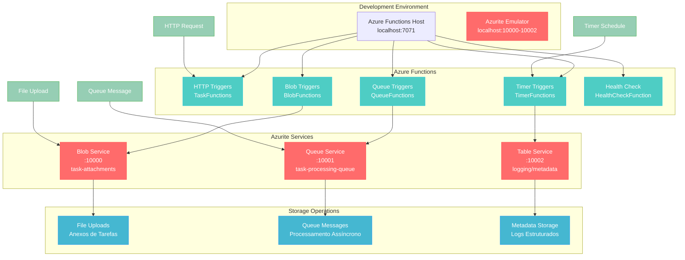
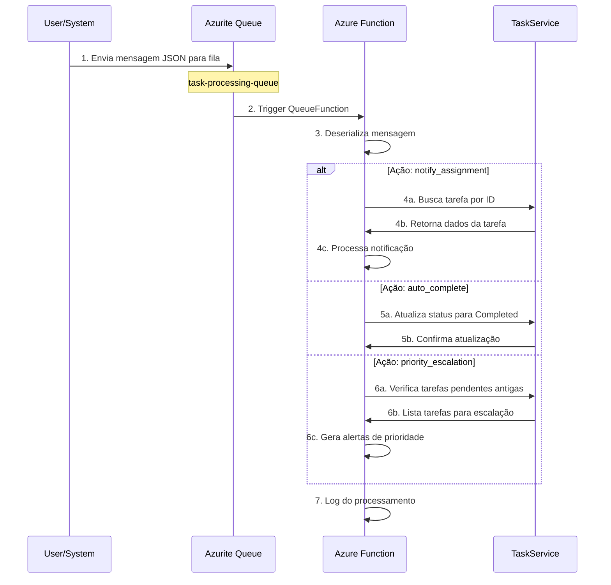
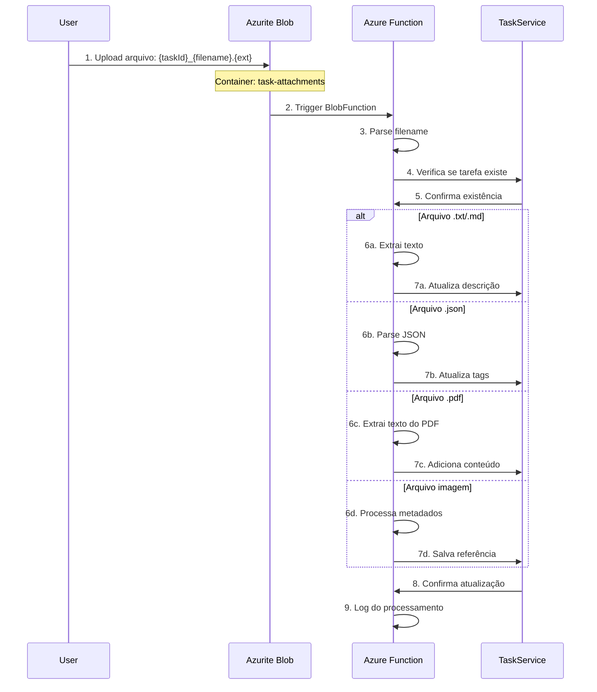

# Guia Completo do Azurite - Emulador Azure Storage Local

## O que é o Azurite?

O **Azurite** é um emulador open-source que simula os serviços de Azure Storage localmente durante o desenvolvimento. Ele fornece uma experiência consistente com a nuvem Azure, permitindo desenvolver e testar aplicações que dependem de Azure Storage sem custos e com total controle local.

### Serviços Emulados

| Serviço | Porta | Funcionalidade | URL Local |
|---------|-------|----------------|-----------|
| **Blob Storage** | 10000 | Armazenamento de arquivos | `http://127.0.0.1:10000` |
| **Queue Storage** | 10001 | Filas de mensagens | `http://127.0.0.1:10001` |
| **Table Storage** | 10002 | Banco NoSQL (tabelas) | `http://127.0.0.1:10002` |

## Papel do Azurite no Nosso Projeto

### Arquitetura Azure Functions + Azurite



## Dependências do Azurite no Projeto

### Functions que DEPENDEM do Azurite

#### 1. Queue Functions - Processamento Assíncrono
```csharp
[Function("ProcessTaskFunction")]
public async Task ProcessTaskFunction(
    [QueueTrigger("task-processing-queue", Connection = "AzureWebJobsStorage")] string queueItem)
```

**Propósito:**
- Processar notificações de atribuição de tarefas
- Auto-conclusão de tarefas baseada em regras
- Escalação de prioridade para tarefas antigas

#### 2. Blob Functions - Processamento de Anexos
```csharp
[Function("ProcessTaskAttachmentFunction")]
public async Task ProcessTaskAttachmentFunction(
    [BlobTrigger("task-attachments/{name}", Connection = "AzureWebJobsStorage")] byte[] blobContent,
    string name)
```

**Propósito:**
- Processar uploads de documentos
- Extrair texto de arquivos .txt/.md para descrições
- Extrair tags de arquivos JSON
- Processar imagens e PDFs

### Functions que NÃO dependem do Azurite

#### HTTP Functions
- `GET/POST/PUT/DELETE /api/tasks` - CRUD de tarefas
- `GET /api/health` - Health checks

#### Timer Functions
- `TimerCleanupFunction` - Limpeza agendada
- `DailyTaskSummary` - Relatórios diários

## Fluxo de Dados com Azurite

### Fluxo Queue (Mensagens Assíncronas)



### Fluxo Blob (Upload de Anexos)



## Configuração do Azurite

### Connection String Local
```json
{
  "AzureWebJobsStorage": "UseDevelopmentStorage=true"
}
```

### Connection String Completa (Alternativa)
```json
{
  "AzureWebJobsStorage": "DefaultEndpointsProtocol=http;AccountName=devstoreaccount1;AccountKey=Eby8vdM02xNOcqFlqUwJPLlmEtlCDXJ1OUzFT50uSRZ6IFsuFq2UVErCz4I6tq/K1SZFPTOtr/KBHBeksoGMGw==;BlobEndpoint=http://127.0.0.1:10000/devstoreaccount1;QueueEndpoint=http://127.0.0.1:10001/devstoreaccount1;TableEndpoint=http://127.0.0.1:10002/devstoreaccount1;"
}
```

## Passo a Passo: Instalação e Configuração

### 1. Instalação do Azurite

#### Via NPM (Recomendado)
```bash
# Instalar globalmente
npm install -g azurite

# Verificar instalação
azurite --version
```

#### Via Docker (Alternativa)
```bash
# Executar container
docker run -p 10000:10000 -p 10001:10001 -p 10002:10002 \
  mcr.microsoft.com/azure-storage/azurite
```

### 2. Inicialização do Azurite

```bash
# Criar diretório para dados
mkdir -p ~/azurite

# Iniciar Azurite
azurite --silent --location ~/azurite --debug ~/azurite/debug.log

# Ou em background
nohup azurite --silent --location ~/azurite > ~/azurite/azurite.log 2>&1 &
```

### 3. Verificação dos Serviços

```bash
# Verificar portas ativas
lsof -i :10000 -i :10001 -i :10002

# Verificar processos
ps aux | grep azurite
```

## Passo a Passo: Testes e Validação

### Pré-requisitos
1. ✅ Azurite rodando (portas 10000, 10001, 10002)
2. ✅ Azure Functions rodando (`func start --port 7071`)
3. ✅ Azure CLI instalado
4. ✅ curl e jq instalados

### Teste 1: Verificação Inicial

```bash
# 1. Verificar health check
curl -s http://localhost:7071/api/health | jq .

# 2. Verificar Azure Functions conectado ao Azurite
curl -s http://localhost:7071/api/health/detailed | jq .

# 3. Verificar se Azurite está respondendo
curl -s "http://127.0.0.1:10000/devstoreaccount1?comp=list" || echo "Azurite ativo!"
```

### Teste 2: Queue Function - Processamento de Mensagens

#### 2.1 Criar a Fila
```bash
az storage queue create \
  --name task-processing-queue \
  --connection-string "DefaultEndpointsProtocol=http;AccountName=devstoreaccount1;AccountKey=Eby8vdM02xNOcqFlqUwJPLlmEtlCDXJ1OUzFT50uSRZ6IFsuFq2UVErCz4I6tq/K1SZFPTOtr/KBHBeksoGMGw==;QueueEndpoint=http://127.0.0.1:10001/devstoreaccount1;"
```

#### 2.2 Criar uma Tarefa para Testar
```bash
TASK_RESPONSE=$(curl -s -X POST http://localhost:7071/api/tasks \
  -H "Content-Type: application/json" \
  -d '{"title":"Teste Queue Function","description":"Tarefa para testar processamento de fila"}')

TASK_ID=$(echo $TASK_RESPONSE | jq -r .data.id)
echo "Task ID criado: $TASK_ID"
```

#### 2.3 Testar Notificação de Atribuição
```bash
az storage message put \
  --queue-name task-processing-queue \
  --content "{\"taskId\":\"$TASK_ID\",\"action\":\"notify_assignment\",\"parameters\":{},\"timestamp\":\"$(date -u +%Y-%m-%dT%H:%M:%SZ)\"}" \
  --connection-string "DefaultEndpointsProtocol=http;AccountName=devstoreaccount1;AccountKey=Eby8vdM02xNOcqFlqUwJPLlmEtlCDXJ1OUzFT50uSRZ6IFsuFq2UVErCz4I6tq/K1SZFPTOtr/KBHBeksoGMGw==;QueueEndpoint=http://127.0.0.1:10001/devstoreaccount1;"

# Aguardar processamento (3-5 segundos)
sleep 5

# Verificar logs do Azure Functions para confirmar processamento
echo "Verifique os logs do Azure Functions para ver: 'Processando notificação de atribuição'"
```

#### 2.4 Testar Auto-Conclusão
```bash
az storage message put \
  --queue-name task-processing-queue \
  --content "{\"taskId\":\"$TASK_ID\",\"action\":\"auto_complete\",\"parameters\":{},\"timestamp\":\"$(date -u +%Y-%m-%dT%H:%M:%SZ)\"}" \
  --connection-string "DefaultEndpointsProtocol=http;AccountName=devstoreaccount1;AccountKey=Eby8vdM02xNOcqFlqUwJPLlmEtlCDXJ1OUzFT50uSRZ6IFsuFq2UVErCz4I6tq/K1SZFPTOtr/KBHBeksoGMGw==;QueueEndpoint=http://127.0.0.1:10001/devstoreaccount1;"

# Aguardar e verificar se status mudou
sleep 5
curl -s http://localhost:7071/api/tasks/$TASK_ID | jq .data.status
```

### Teste 3: Blob Function - Processamento de Anexos

#### 3.1 Criar Container
```bash
az storage container create \
  --name task-attachments \
  --connection-string "DefaultEndpointsProtocol=http;AccountName=devstoreaccount1;AccountKey=Eby8vdM02xNOcqFlqUwJPLlmEtlCDXJ1OUzFT50uSRZ6IFsuFq2UVErCz4I6tq/K1SZFPTOtr/KBHBeksoGMGw==;BlobEndpoint=http://127.0.0.1:10000/devstoreaccount1;"
```

#### 3.2 Teste de Arquivo de Texto (Atualização de Descrição)
```bash
# Criar arquivo de teste
echo "Descrição adicional extraída automaticamente do arquivo de texto anexado à tarefa." > description.txt

# Upload do arquivo
az storage blob upload \
  --container-name task-attachments \
  --file description.txt \
  --name "${TASK_ID}_description.txt" \
  --connection-string "DefaultEndpointsProtocol=http;AccountName=devstoreaccount1;AccountKey=Eby8vdM02xNOcqFlqUwJPLlmEtlCDXJ1OUzFT50uSRZ6IFsuFq2UVErCz4I6tq/K1SZFPTOtr/KBHBeksoGMGw==;BlobEndpoint=http://127.0.0.1:10000/devstoreaccount1;"

# Aguardar processamento
sleep 5

# Verificar se descrição foi atualizada
curl -s http://localhost:7071/api/tasks/$TASK_ID | jq .data.description

# Limpeza
rm description.txt
```

#### 3.3 Teste de Arquivo JSON (Extração de Tags)
```bash
# Criar arquivo JSON com tags
echo '{"tags": ["blob-processed", "automatic-extraction", "azure-functions", "test"]}' > tags.json

# Upload do arquivo
az storage blob upload \
  --container-name task-attachments \
  --file tags.json \
  --name "${TASK_ID}_metadata.json" \
  --connection-string "DefaultEndpointsProtocol=http;AccountName=devstoreaccount1;AccountKey=Eby8vdM02xNOcqFlqUwJPLlmEtlCDXJ1OUzFT50uSRZ6IFsuFq2UVErCz4I6tq/K1SZFPTOtr/KBHBeksoGMGw==;BlobEndpoint=http://127.0.0.1:10000/devstoreaccount1;"

# Aguardar processamento
sleep 5

# Verificar se tags foram atualizadas
curl -s http://localhost:7071/api/tasks/$TASK_ID | jq .data.tags

# Limpeza
rm tags.json
```

#### 3.4 Teste de Arquivo Markdown
```bash
# Criar arquivo markdown
echo "# Notas Adicionais\n\nEste arquivo markdown foi processado automaticamente pela Blob Function.\n\n- Item 1\n- Item 2\n- Item 3" > notes.md

# Upload do arquivo
az storage blob upload \
  --container-name task-attachments \
  --file notes.md \
  --name "${TASK_ID}_notes.md" \
  --connection-string "DefaultEndpointsProtocol=http;AccountName=devstoreaccount1;AccountKey=Eby8vdM02xNOcqFlqUwJPLlmEtlCDXJ1OUzFT50uSRZ6IFsuFq2UVErCz4I6tq/K1SZFPTOtr/KBHBeksoGMGw==;BlobEndpoint=http://127.0.0.1:10000/devstoreaccount1;"

# Aguardar processamento
sleep 5

# Verificar resultado
curl -s http://localhost:7071/api/tasks/$TASK_ID | jq .data.description

# Limpeza
rm notes.md
```

### Teste 4: Verificação Final do Sistema

```bash
# 1. Health check completo
curl -s http://localhost:7071/api/health/detailed | jq .

# 2. Verificar tarefa final
curl -s http://localhost:7071/api/tasks/$TASK_ID | jq .data

# 3. Verificar estatísticas do sistema
curl -s http://localhost:7071/api/tasks | jq '.data | length'

# 4. Verificar storage do Azurite
az storage queue list \
  --connection-string "DefaultEndpointsProtocol=http;AccountName=devstoreaccount1;AccountKey=Eby8vdM02xNOcqFlqUwJPLlmEtlCDXJ1OUzFT50uSRZ6IFsuFq2UVErCz4I6tq/K1SZFPTOtr/KBHBeksoGMGw==;QueueEndpoint=http://127.0.0.1:10001/devstoreaccount1;"

az storage blob list \
  --container-name task-attachments \
  --connection-string "DefaultEndpointsProtocol=http;AccountName=devstoreaccount1;AccountKey=Eby8vdM02xNOcqFlqUwJPLlmEtlCDXJ1OUzFT50uSRZ6IFsuFq2UVErCz4I6tq/K1SZFPTOtr/KBHBeksoGMGw==;BlobEndpoint=http://127.0.0.1:10000/devstoreaccount1;"
```

## Script de Teste Automatizado

### test-azurite.sh
```bash
#!/bin/bash

echo "🔍 Iniciando testes completos do Azurite..."

# Configurações
BASE_URL="http://localhost:7071/api"
CONN_STRING="DefaultEndpointsProtocol=http;AccountName=devstoreaccount1;AccountKey=Eby8vdM02xNOcqFlqUwJPLlmEtlCDXJ1OUzFT50uSRZ6IFsuFq2UVErCz4I6tq/K1SZFPTOtr/KBHBeksoGMGw=="
QUEUE_CONN="${CONN_STRING};QueueEndpoint=http://127.0.0.1:10001/devstoreaccount1;"
BLOB_CONN="${CONN_STRING};BlobEndpoint=http://127.0.0.1:10000/devstoreaccount1;"

# 1. Verificar serviços
echo "✅ Verificando serviços..."
curl -s $BASE_URL/health | jq .status

# 2. Criar recursos do Azurite
echo "🏗️ Criando recursos do Azurite..."
az storage queue create --name task-processing-queue --connection-string "$QUEUE_CONN" > /dev/null
az storage container create --name task-attachments --connection-string "$BLOB_CONN" > /dev/null

# 3. Criar tarefa de teste
echo "📝 Criando tarefa de teste..."
TASK_RESPONSE=$(curl -s -X POST $BASE_URL/tasks \
  -H "Content-Type: application/json" \
  -d '{"title":"Teste Azurite Automatizado","description":"Teste completo de integração"}')
TASK_ID=$(echo $TASK_RESPONSE | jq -r .data.id)
echo "📋 Task ID: $TASK_ID"

# 4. Teste Queue Function
echo "📨 Testando Queue Function..."
az storage message put \
  --queue-name task-processing-queue \
  --content "{\"taskId\":\"$TASK_ID\",\"action\":\"notify_assignment\",\"parameters\":{},\"timestamp\":\"$(date -u +%Y-%m-%dT%H:%M:%SZ)\"}" \
  --connection-string "$QUEUE_CONN" > /dev/null

# 5. Teste Blob Function
echo "📁 Testando Blob Function..."
echo "Conteúdo processado automaticamente!" > test-content.txt
az storage blob upload \
  --container-name task-attachments \
  --file test-content.txt \
  --name "${TASK_ID}_content.txt" \
  --connection-string "$BLOB_CONN" > /dev/null

# 6. Aguardar processamento
echo "⏳ Aguardando processamento (10 segundos)..."
sleep 10

# 7. Verificar resultados
echo "🔍 Verificando resultados..."
FINAL_TASK=$(curl -s $BASE_URL/tasks/$TASK_ID)
echo "📄 Descrição atualizada: $(echo $FINAL_TASK | jq .data.description)"

# 8. Status final
echo "✨ Teste completo do Azurite concluído!"
curl -s $BASE_URL/health/detailed | jq .overallStatus

# Limpeza
rm -f test-content.txt
```

## Problemas Comuns e Soluções

### 1. Azurite não inicia
```bash
# Verificar se as portas estão em uso
lsof -i :10000 -i :10001 -i :10002

# Matar processos se necessário
pkill -f azurite

# Reiniciar
azurite --silent --location ~/azurite
```

### 2. Azure Functions não conecta
```bash
# Verificar connection string no local.settings.json
cat local.settings.json | jq .Values.AzureWebJobsStorage

# Reiniciar Azure Functions
func start --port 7071
```

### 3. Queue/Blob não funciona
```bash
# Verificar se recursos existem
az storage queue list --connection-string "UseDevelopmentStorage=true"
az storage container list --connection-string "UseDevelopmentStorage=true"

# Recriar se necessário
az storage queue create --name task-processing-queue --connection-string "UseDevelopmentStorage=true"
az storage container create --name task-attachments --connection-string "UseDevelopmentStorage=true"
```

## Monitoramento e Logs

### 1. Logs do Azurite
```bash
# Iniciar com logs detalhados
azurite --silent --location ~/azurite --debug ~/azurite/debug.log

# Acompanhar logs
tail -f ~/azurite/debug.log
```

### 2. Logs do Azure Functions
```bash
# Logs aparecem diretamente no terminal onde func start foi executado
# Buscar por:
# - "Processando mensagem da fila"
# - "Processando anexo de tarefa"
# - "Anexo processado com sucesso"
```

### 3. Métricas do Sistema
```bash
# Health check detalhado com estatísticas
curl -s http://localhost:7071/api/health/detailed | jq .

# Verificar quantidade de mensagens na fila
az storage message peek --queue-name task-processing-queue --connection-string "UseDevelopmentStorage=true"

# Listar blobs no container
az storage blob list --container-name task-attachments --connection-string "UseDevelopmentStorage=true"
```

## Conclusão

O **Azurite** é fundamental para o desenvolvimento local do nosso sistema de gestão de tarefas. Ele permite:

- ✅ **Desenvolvimento completo offline**
- ✅ **Testes de event-driven architecture**
- ✅ **Simulação idêntica à produção**
- ✅ **Zero custos de desenvolvimento**
- ✅ **Controle total sobre dados de teste**

Sem o Azurite, apenas 60% das funcionalidades estariam disponíveis localmente. Com ele, temos 100% das funcionalidades do sistema funcionando em desenvolvimento, proporcionando uma experiência de desenvolvimento completa e confiável.

O sistema suporta processamento assíncrono via filas, anexos de arquivos via blob storage, e mantém a mesma arquitetura que será usada em produção, garantindo que o que funciona localmente também funcionará na nuvem Azure.

