# Diagramas de Sequência - Sistema de Gestão de Tarefas

## HTTP Functions (CRUD de Tarefas)

### 1. GET /api/tasks - Listar Todas as Tarefas

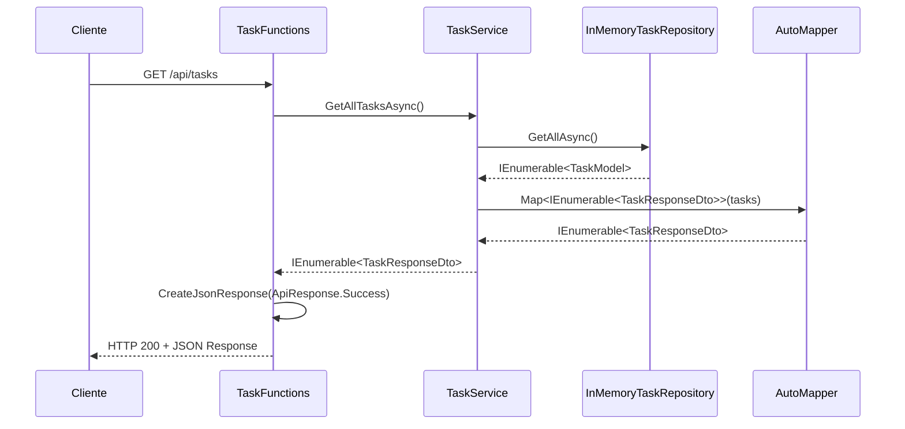

### 2. GET /api/tasks/{id} - Obter Tarefa por ID

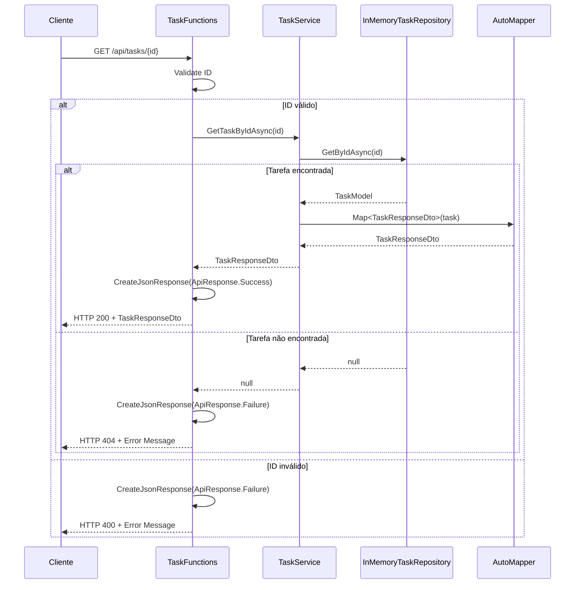

### 3. POST /api/tasks - Criar Nova Tarefa

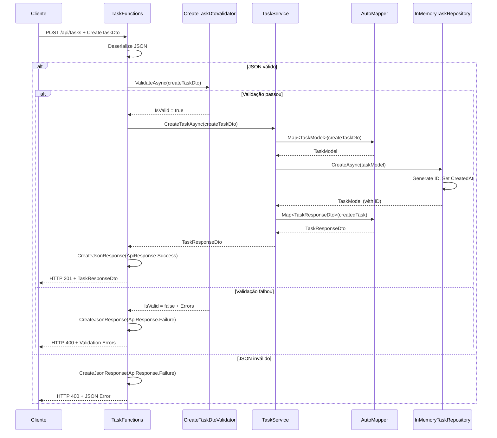

### 4. PUT /api/tasks/{id} - Atualizar Tarefa

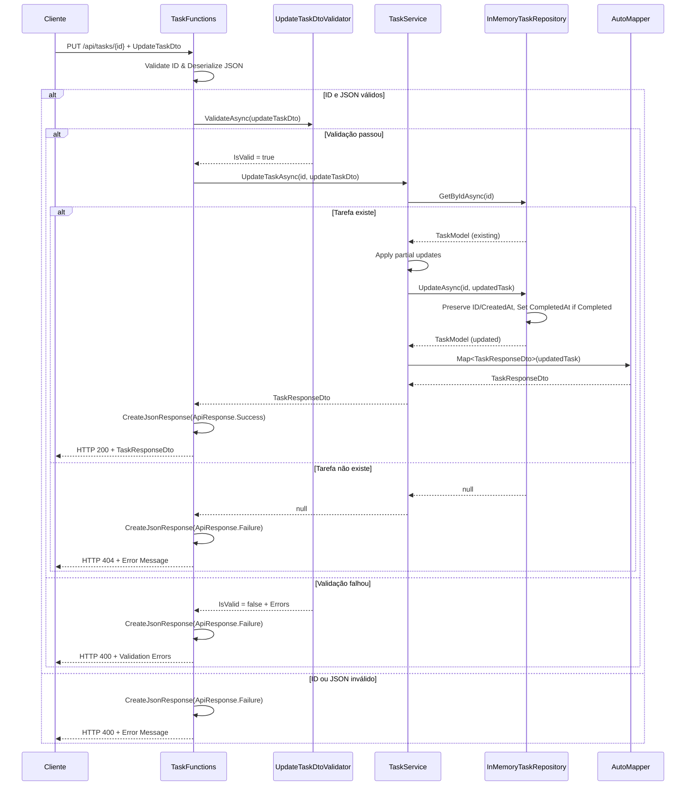

### 5. DELETE /api/tasks/{id} - Deletar Tarefa

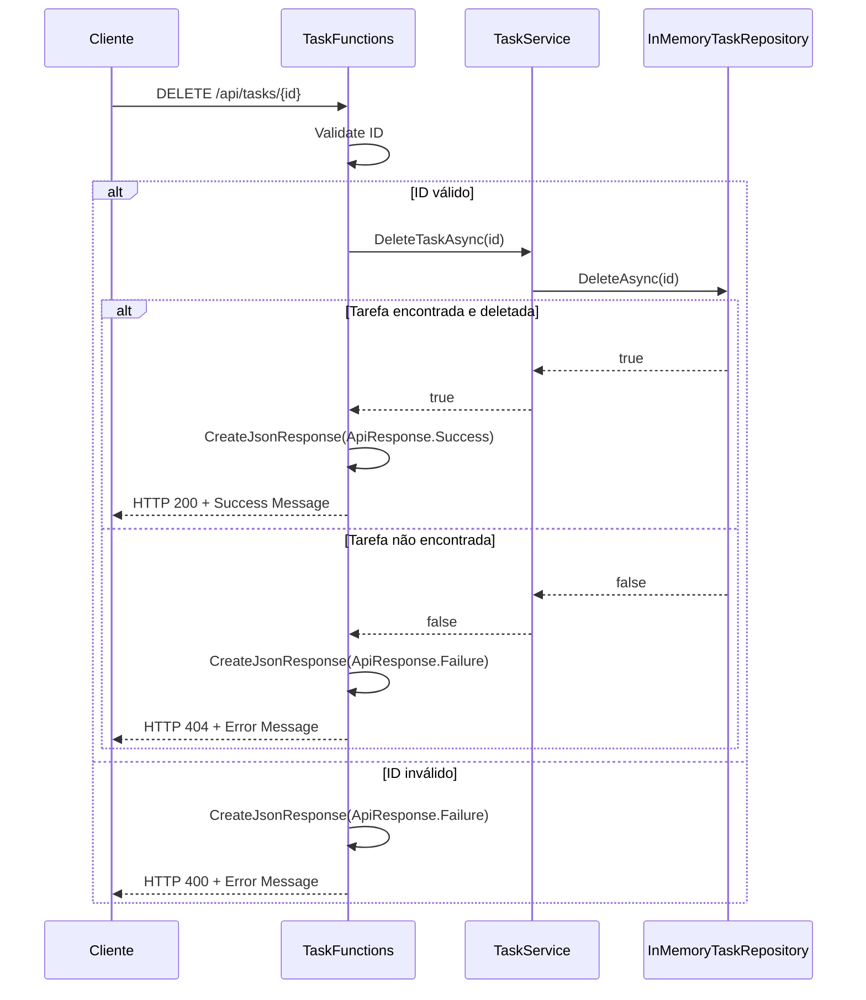

### 6. GET /api/tasks/status/{status} - Filtrar por Status

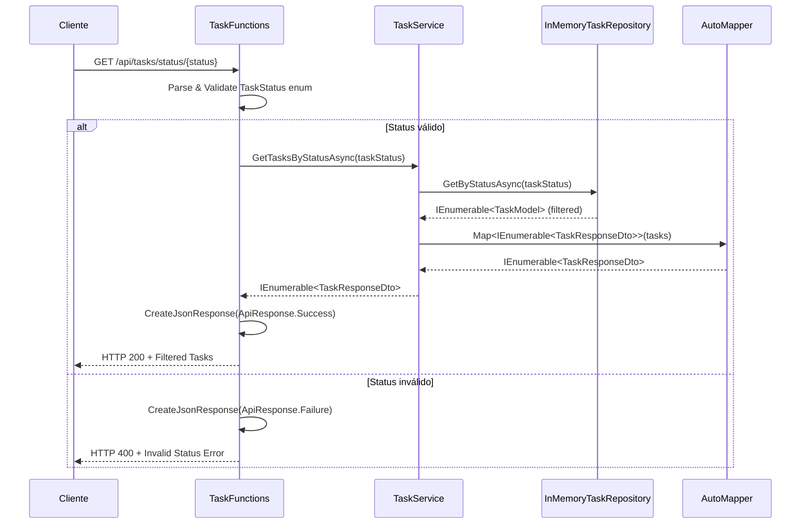

## Health Check Functions

### 7. GET /api/health - Health Check Básico

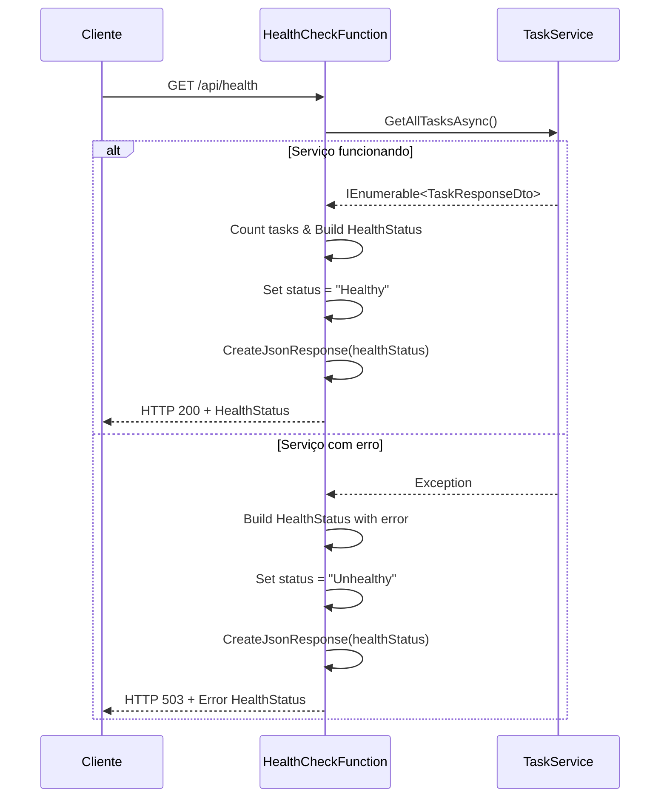

### 8. GET /api/health/detailed - Health Check Detalhado

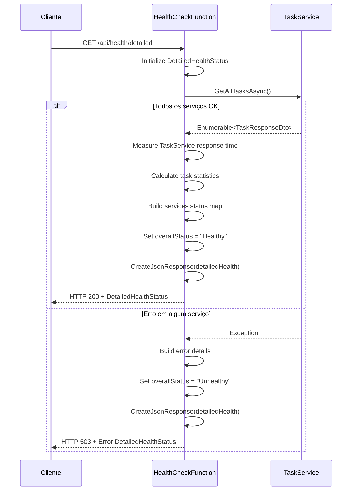

## Timer Functions (Scheduled)

### 9. Timer: Limpeza Automática de Tarefas

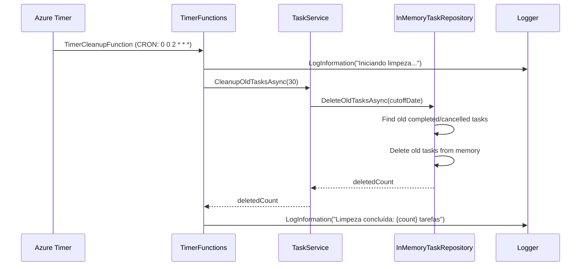

### 10. Timer: Relatório Diário de Tarefas

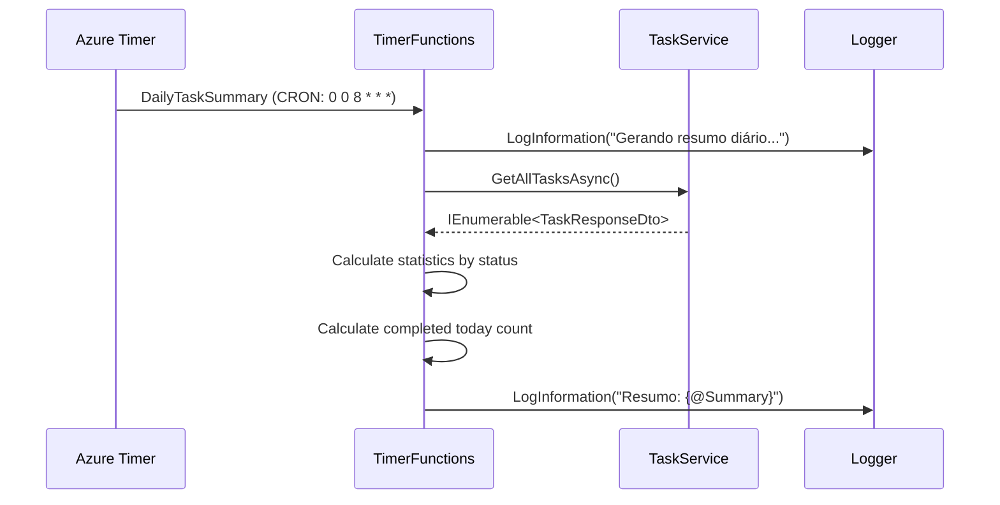

## Queue Functions (Message Processing)

### 11. Queue: Processamento de Mensagens

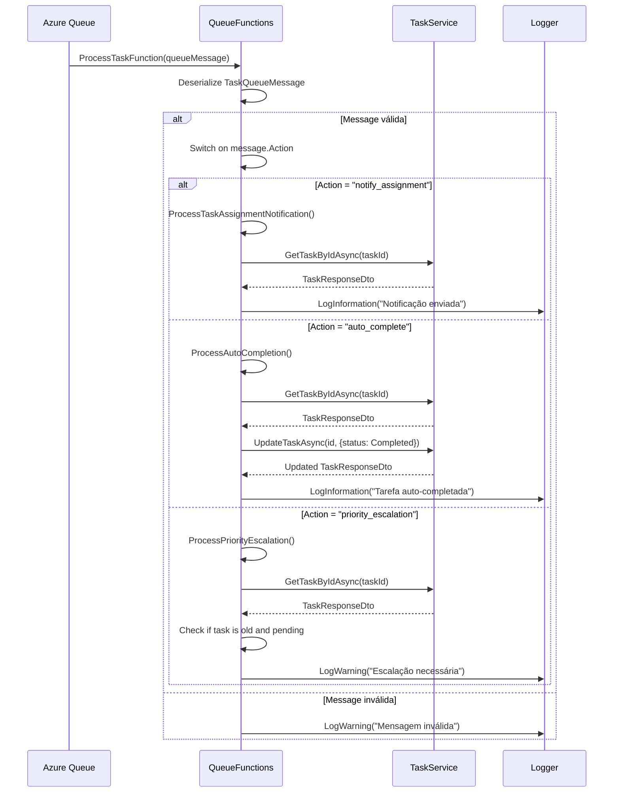

## Blob Functions (File Processing)

### 12. Blob: Processamento de Anexos

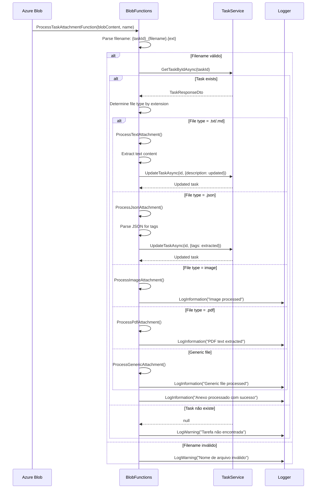

## Middleware (Exception Handling)

### 13. Exception Handling Middleware

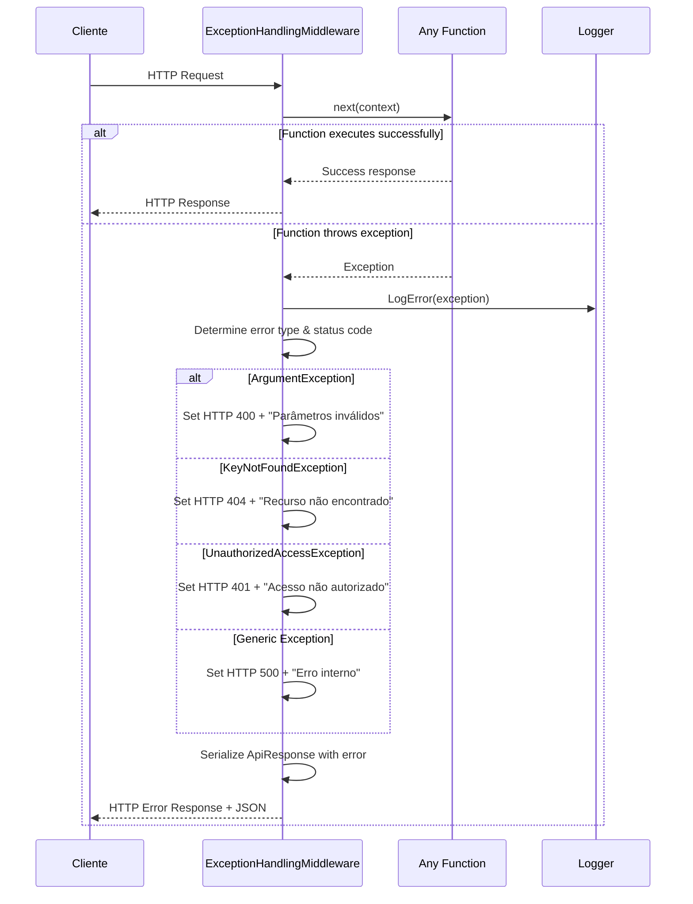
