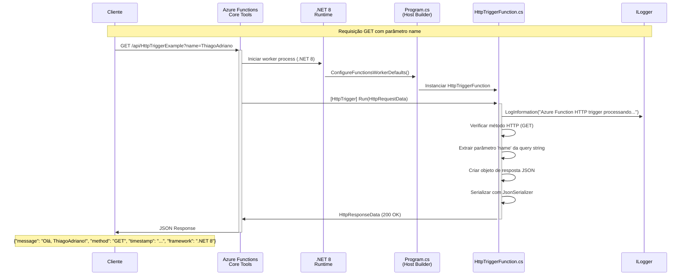
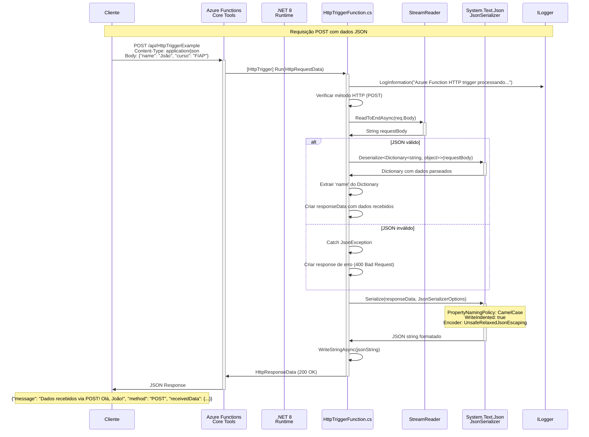
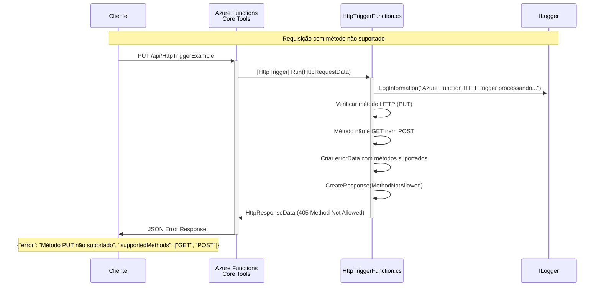
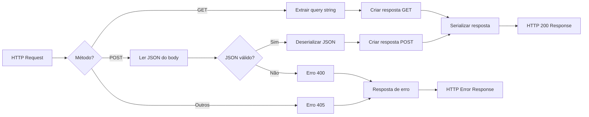

# Diagrama de Sequência - Azure Function .NET

Este diagrama mostra como funciona o fluxo de uma requisição HTTP no projeto Azure Function .NET.

## Cenário 1: Requisição GET



## Cenário 2: Requisição POST



## Cenário 3: Método Não Suportado (Erro 405)



## Arquitetura do Sistema

```mermaid
graph TB
    subgraph "Cliente"
        Browser[Browser/Postman/curl]
        RestClient[VS Code REST Client]
    end
    
    subgraph "Azure Functions Local"
        CoreTools[Azure Functions Core Tools<br/>Port 7071]
        
        subgraph ".NET 8 Runtime"
            Host[Host Builder<br/>Program.cs]
            DI[Dependency Injection<br/>ILogger, Application Insights]
            
            subgraph "Function App"
                HttpFunc[HttpTriggerFunction.cs<br/>[GET, POST]]
                Config[Configuration<br/>host.json, local.settings.json]
            end
        end
    end
    
    subgraph "Infraestrutura"
        AppInsights[Application Insights<br/>Telemetry]
        Storage[Azure Storage<br/>UseDevelopmentStorage]
    end
    
    Browser --> CoreTools
    RestClient --> CoreTools
    CoreTools --> Host
    Host --> DI
    DI --> HttpFunc
    HttpFunc --> Config
    HttpFunc --> AppInsights
    CoreTools --> Storage
```

## Fluxo de Dados



## Configurações Importantes

### host.json
- **version**: 2.0
- **extensionBundle**: Microsoft.Azure.Functions.ExtensionBundle v4
- **functionTimeout**: 5 minutos
- **logging**: Application Insights habilitado

### local.settings.json
- **FUNCTIONS_WORKER_RUNTIME**: dotnet-isolated
- **AzureWebJobsStorage**: UseDevelopmentStorage=true
- **FUNCTIONS_EXTENSION_VERSION**: ~4

### Dependências (.csproj)
- **Microsoft.Azure.Functions.Worker**: 1.21.0
- **Microsoft.Azure.Functions.Worker.Extensions.Http**: 3.2.0
- **Microsoft.ApplicationInsights.WorkerService**: 2.22.0
- **Target Framework**: .NET 8.0

## Logs de Execução

Durante a execução, você verá logs como:

```
[2025-08-22T14:47:40.039Z] Executing 'Functions.HttpTriggerExample' (Id=fec864e3-3429-4ca4-b3fb-b07128defcfc)
[2025-08-22T14:47:40.049Z] Azure Function HTTP trigger processando uma requisição.
[2025-08-22T14:47:40.051Z] Executed 'Functions.HttpTriggerExample' (Succeeded, Duration=14ms)
```

Isso mostra:
1. **Inicio da execução** com ID único
2. **Log personalizado** da função
3. **Fim da execução** com duração
