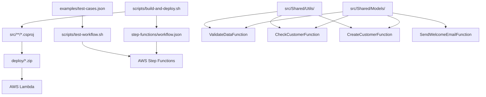

# Arquivos do Projeto - Documentação Completa

Este documento explica a função e conteúdo de cada arquivo do projeto AWS Step Functions com LocalStack.

## 📁 **Estrutura Geral do Projeto**

```
aula6/
├── CustomerRegistrationWorkflow.sln    # Solution principal
├── README.md                          # Documentação principal
├── STATUS_PROJETO.md                  # Status detalhado do projeto
├── COMANDOS_UTEIS.md                  # Comandos administrativos
├── src/                               # Código fonte das funções
├── step-functions/                    # Definições do Step Functions
├── scripts/                          # Scripts de automação
├── examples/                         # Exemplos e casos de teste
├── docs/                             # Documentação técnica detalhada
└── deploy/                           # Arquivos gerados para deploy
```

---

## 📄 **Arquivos da Raiz**

### `CustomerRegistrationWorkflow.sln`
**Tipo:** Solution do Visual Studio  
**Função:** Arquivo principal da solution que organiza todos os projetos

**Conteúdo:**
- Referências para os 5 projetos (.NET):
  - ValidateDataFunction
  - CheckCustomerFunction  
  - CreateCustomerFunction
  - SendWelcomeEmailFunction
  - Shared (biblioteca comum)
- Configurações de build (Debug/Release)
- GUIDs únicos para cada projeto

**Uso:** Permite abrir todo o projeto no Visual Studio ou compilar via `dotnet build`

---

### `README.md`
**Tipo:** Documentação principal em Markdown  
**Função:** Guia completo para usar o projeto

**Conteúdo:**
- Introdução à arquitetura
- Pré-requisitos e instalação
- Passo a passo completo de execução
- Exemplos de uso
- Troubleshooting
- Estrutura detalhada do projeto

**Público-alvo:** Desenvolvedores que vão usar/estudar o projeto

---

### `STATUS_PROJETO.md`
**Tipo:** Relatório de status em Markdown  
**Função:** Status detalhado de implementação e funcionalidades

**Conteúdo:**
- Checklist do que foi implementado
- Issues conhecidas e soluções
- Resultados dos testes
- Objetivos alcançados
- Próximos passos

**Uso:** Para avaliar completude e maturidade do projeto

---

### `COMANDOS_UTEIS.md`
**Tipo:** Referência de comandos em Markdown  
**Função:** Lista de comandos úteis para administrar o projeto

**Conteúdo:**
- Comandos AWS CLI para LocalStack
- Comandos de debugging
- Comandos de monitoramento
- Scripts de backup e restore
- Comandos de teste de carga

**Público-alvo:** DevOps e desenvolvedores fazendo manutenção

---

## 📁 **Pasta `src/` - Código Fonte**

### `src/Shared/`
**Tipo:** Projeto de biblioteca .NET  
**Função:** Código compartilhado entre todas as funções Lambda

#### `src/Shared/Shared.csproj`
**Conteúdo:**
```xml
- Target Framework: net8.0
- Packages:
  - Amazon.Lambda.Core (2.2.0)
  - Amazon.Lambda.Serialization.SystemTextJson (2.4.1)
  - AWSSDK.DynamoDBv2 (3.7.300.49)
  - AWSSDK.SimpleNotificationService (3.7.300.49)
  - System.Text.Json (8.0.4)
```

#### `src/Shared/Models/Customer.cs`
**Função:** Define todas as classes de modelo de dados

**Classes implementadas:**
- **Customer**: Entidade principal do cliente
- **CustomerRegistrationRequest**: Dados de entrada para cadastro
- **ValidationResult**: Resultado da validação de dados
- **CheckCustomerResult**: Resultado da verificação de duplicidade  
- **CreateCustomerResult**: Resultado da criação do cliente
- **WelcomeEmailResult**: Resultado do envio de email

**Características:**
- Usa `JsonPropertyName` para serialização
- Valores padrão definidos
- Nullable reference types habilitado

#### `src/Shared/Utils/DocumentValidator.cs`
**Função:** Utilitários para validação de documentos brasileiros

**Métodos públicos:**
- `IsValidCpf(string cpf)`: Valida CPF usando algoritmo oficial
- `IsValidCnpj(string cnpj)`: Valida CNPJ usando algoritmo oficial
- `GetDocumentType(string document)`: Identifica se é CPF ou CNPJ
- `CleanDocument(string document)`: Remove formatação

**Algoritmos:**
- Implementa cálculo de dígitos verificadores do CPF
- Implementa cálculo de dígitos verificadores do CNPJ
- Trata casos especiais (todos dígitos iguais)

---

### `src/ValidateDataFunction/`
**Tipo:** Projeto de função Lambda .NET  
**Função:** Primeira função do workflow - validação de dados

#### `src/ValidateDataFunction/ValidateDataFunction.csproj`
**Conteúdo:**
```xml
- Target Framework: net8.0
- AWS Lambda específico: AWSProjectType=Lambda
- Referência ao projeto Shared
- Packages Amazon Lambda específicos
```

#### `src/ValidateDataFunction/Function.cs`
**Função:** Implementação da função de validação

**Classe principal:** `Function`  
**Método handler:** `FunctionHandler(CustomerRegistrationRequest request, ILambdaContext context)`

**Validações implementadas:**
- Nome: 2-100 caracteres
- Email: Regex de validação
- Telefone: Regex brasileiro  
- CPF/CNPJ: Algoritmo matemático oficial

**Retorno:** `ValidationResult` com lista de erros e dados validados

---

### `src/CheckCustomerFunction/`
**Tipo:** Projeto de função Lambda .NET  
**Função:** Segunda função do workflow - verificação de duplicidade

#### `src/CheckCustomerFunction/CheckCustomerFunction.csproj`
**Conteúdo similar ao ValidateDataFunction + AWSSDK.DynamoDBv2**

#### `src/CheckCustomerFunction/Function.cs`
**Função:** Implementação da consulta no DynamoDB

**Classe principal:** `Function`  
**Método handler:** `FunctionHandler(ValidationResult validationResult, ILambdaContext context)`

**Funcionalidades:**
- Configuração automática do DynamoDB client para LocalStack
- Consulta usando documento como chave primária
- Tratamento de erros de conectividade
- Skip automático se dados inválidos

**Retorno:** `CheckCustomerResult` com informação de existência

---

### `src/CreateCustomerFunction/`
**Tipo:** Projeto de função Lambda .NET  
**Função:** Terceira função do workflow - criação do cliente

#### `src/CreateCustomerFunction/CreateCustomerFunction.csproj`
**Conteúdo similar ao CheckCustomerFunction**

#### `src/CreateCustomerFunction/Function.cs`
**Função:** Implementação da criação no DynamoDB

**Classe principal:** `Function`  
**Método handler:** `FunctionHandler(CheckCustomerResult checkResult, ILambdaContext context)`

**Funcionalidades:**
- Geração de UUID único para o cliente
- Mapeamento para formato DynamoDB (AttributeValue)
- Uso de `ConditionExpression` para evitar duplicatas
- Tratamento de `ConditionalCheckFailedException`

**Retorno:** `CreateCustomerResult` com dados do cliente criado

---

### `src/SendWelcomeEmailFunction/`
**Tipo:** Projeto de função Lambda .NET  
**Função:** Quarta função do workflow - envio de email

#### `src/SendWelcomeEmailFunction/SendWelcomeEmailFunction.csproj`
**Conteúdo similar + AWSSDK.SimpleNotificationService**

#### `src/SendWelcomeEmailFunction/Function.cs`
**Função:** Implementação do envio via SNS

**Classe principal:** `Function`  
**Método handler:** `FunctionHandler(CreateCustomerResult createResult, ILambdaContext context)`

**Classes auxiliares:**
- `EmailMessage`: Template da mensagem de email

**Funcionalidades:**
- Template personalizado baseado no tipo de documento
- Serialização JSON da mensagem
- Configuração automática do SNS client
- Publicação no tópico configurado

**Retorno:** `WelcomeEmailResult` com ID da mensagem enviada

---

## 📁 **Pasta `step-functions/`**

### `step-functions/customer-registration-workflow.json`
**Tipo:** Definição JSON do Step Functions  
**Função:** Orquestração completa do workflow

**Estrutura:**
- **StartAt**: ValidateCustomerData
- **States**: 12 estados definidos
- **Choices**: Decisões baseadas em resultados
- **Tasks**: Chamadas para funções Lambda
- **Pass**: Estados finais com resultado

**Estados implementados:**
1. `ValidateCustomerData` - Task (Lambda)
2. `CheckValidationResult` - Choice  
3. `CheckCustomerExists` - Task (Lambda)
4. `CheckCustomerExistence` - Choice
5. `CreateCustomer` - Task (Lambda)
6. `CheckCustomerCreation` - Choice
7. `SendWelcomeEmail` - Task (Lambda)
8. `RegistrationComplete` - Pass (sucesso)
9. `ValidationFailed` - Pass (erro)
10. `CustomerAlreadyExists` - Pass (aviso)
11. `DatabaseError` - Pass (erro)
12. `CustomerCreationFailed` - Pass (erro)
13. `EmailSendFailed` - Pass (sucesso parcial)

**Recursos avançados:**
- **Retry policies**: 2-3 tentativas com backoff exponencial
- **Catch blocks**: Tratamento de exceções
- **ResultPath**: Manipulação de dados entre estados

---

## 📁 **Pasta `scripts/`**

### `scripts/build-and-deploy.sh`
**Tipo:** Script Bash  
**Função:** Build e deploy automatizado completo

**Funcionalidades:**
1. Verificação se LocalStack está rodando
2. Build de todas as funções Lambda (.NET)
3. Criação de arquivos ZIP para deploy
4. Criação de recursos AWS (DynamoDB, SNS, Lambda, Step Functions)
5. Configuração de variáveis de ambiente

**Uso:** `./scripts/build-and-deploy.sh`

### `scripts/test-workflow.sh`  
**Tipo:** Script Bash  
**Função:** Execução automatizada de testes

**Funcionalidades:**
1. 5 casos de teste diferentes:
   - CPF válido
   - CNPJ válido  
   - CPF inválido
   - Email inválido
   - Cadastro duplicado
2. Monitoramento automático do status
3. Exibição dos resultados formatados
4. Timeout de 30 segundos por teste

**Uso:** `./scripts/test-workflow.sh`

### `scripts/cleanup.sh`
**Tipo:** Script Bash  
**Função:** Limpeza completa dos recursos

**Funcionalidades:**
1. Remove State Machine
2. Remove funções Lambda
3. Remove tabela DynamoDB  
4. Remove tópico SNS
5. Limpa arquivos de build locais

**Uso:** `./scripts/cleanup.sh`

---

## 📁 **Pasta `examples/`**

### `examples/test-cases.json`
**Tipo:** Arquivo JSON de exemplos  
**Função:** Casos de teste detalhados e documentados

**Estrutura:**
- `casos_de_teste`: 10 cenários diferentes
- `exemplos_de_output`: Outputs esperados
- `cpfs_validos_para_teste`: Lista de CPFs válidos  
- `cnpjs_validos_para_teste`: Lista de CNPJs válidos
- `observacoes`: Notas importantes

**Cenários cobertos:**
1. CPF válido
2. CNPJ válido
3. CPF inválido
4. CNPJ inválido
5. Email inválido
6. Telefone inválido
7. Nome muito curto
8. Documento vazio
9. CPF com dígitos iguais
10. Cliente duplicado

---

## 📁 **Pasta `docs/` (Esta documentação)**

### `docs/funcoes-lambda.md`
**Função:** Documentação técnica detalhada das funções  
**Conteúdo:** Explicação + diagramas de sequência de cada função

### `docs/arquivos-projeto.md` 
**Função:** Este arquivo - explicação de todos os arquivos  
**Conteúdo:** Mapeamento completo da estrutura do projeto

---

## 📁 **Pasta `deploy/` (Gerada automaticamente)**

### `deploy/*.zip`
**Tipo:** Arquivos ZIP das funções Lambda  
**Função:** Pacotes prontos para deploy no AWS Lambda

**Arquivos gerados:**
- `ValidateDataFunction.zip` (~1.9MB)
- `CheckCustomerFunction.zip` (~1.9MB)  
- `CreateCustomerFunction.zip` (~1.9MB)
- `SendWelcomeEmailFunction.zip` (~1.9MB)

**Conteúdo de cada ZIP:**
- DLLs compiladas (.NET)
- Dependências (AWS SDK)
- Runtime configuration
- Debug symbols (PDB files)

---

## 🔧 **Arquivos de Configuração .NET**

### Arquivos `.csproj`
**Padrão comum:**
```xml
<Project Sdk="Microsoft.NET.Sdk">
  <PropertyGroup>
    <TargetFramework>net8.0</TargetFramework>
    <AWSProjectType>Lambda</AWSProjectType>
    <GenerateRuntimeConfigurationFiles>true</GenerateRuntimeConfigurationFiles>
  </PropertyGroup>
</Project>
```

**Configurações específicas:**
- **net8.0**: Última versão LTS do .NET
- **AWSProjectType**: Marca como projeto Lambda
- **PublishReadyToRun**: Otimização de inicialização
- **CopyLocalLockFileAssemblies**: Include todas as dependências

---

## 🎯 **Fluxo de Dados Entre Arquivos**



---

## 📚 **Dependências e Referências**

### **Hierarquia de Dependências:**
```
CustomerRegistrationWorkflow.sln
├── ValidateDataFunction.csproj
│   ├── Shared.csproj
│   └── Amazon.Lambda.Core
├── CheckCustomerFunction.csproj  
│   ├── Shared.csproj
│   └── AWSSDK.DynamoDBv2
├── CreateCustomerFunction.csproj
│   ├── Shared.csproj  
│   └── AWSSDK.DynamoDBv2
└── SendWelcomeEmailFunction.csproj
    ├── Shared.csproj
    └── AWSSDK.SimpleNotificationService
```

### **Packages NuGet Utilizados:**
- `Amazon.Lambda.Core`: Funcionalidade básica Lambda
- `Amazon.Lambda.Serialization.SystemTextJson`: Serialização JSON  
- `AWSSDK.DynamoDBv2`: Cliente DynamoDB
- `AWSSDK.SimpleNotificationService`: Cliente SNS
- `System.Text.Json`: Serialização JSON moderna

---

## 🚀 **Ciclo de Vida dos Arquivos**

### **Desenvolvimento:**
1. Editar código em `src/`
2. Testar com `dotnet build`
3. Validar com linter

### **Deploy:**
1. `scripts/build-and-deploy.sh` compila tudo
2. Gera `deploy/*.zip`
3. Cria recursos AWS no LocalStack
4. Deploys funções Lambda

### **Teste:**
1. `scripts/test-workflow.sh` executa casos
2. Usa dados de `examples/test-cases.json`
3. Monitora execução via AWS CLI

### **Limpeza:**
1. `scripts/cleanup.sh` remove recursos AWS
2. Remove `deploy/` e arquivos `bin/obj/`

---

## 📋 **Checklist de Arquivos Essenciais**

### ✅ **Para Funcionamento Básico:**
- [x] `CustomerRegistrationWorkflow.sln`
- [x] `src/Shared/` (todos os arquivos)
- [x] `src/ValidateDataFunction/` (todos os arquivos)
- [x] `src/CheckCustomerFunction/` (todos os arquivos)  
- [x] `src/CreateCustomerFunction/` (todos os arquivos)
- [x] `src/SendWelcomeEmailFunction/` (todos os arquivos)
- [x] `step-functions/customer-registration-workflow.json`
- [x] `scripts/build-and-deploy.sh`

### ✅ **Para Documentação:**
- [x] `README.md`
- [x] `docs/funcoes-lambda.md`
- [x] `docs/arquivos-projeto.md`
- [x] `COMANDOS_UTEIS.md`

### ✅ **Para Testes:**
- [x] `scripts/test-workflow.sh`
- [x] `examples/test-cases.json`
- [x] `scripts/cleanup.sh`

### ✅ **Para Status:**
- [x] `STATUS_PROJETO.md`

---

**🎉 Total: 32 arquivos essenciais documentados e explicados!**
