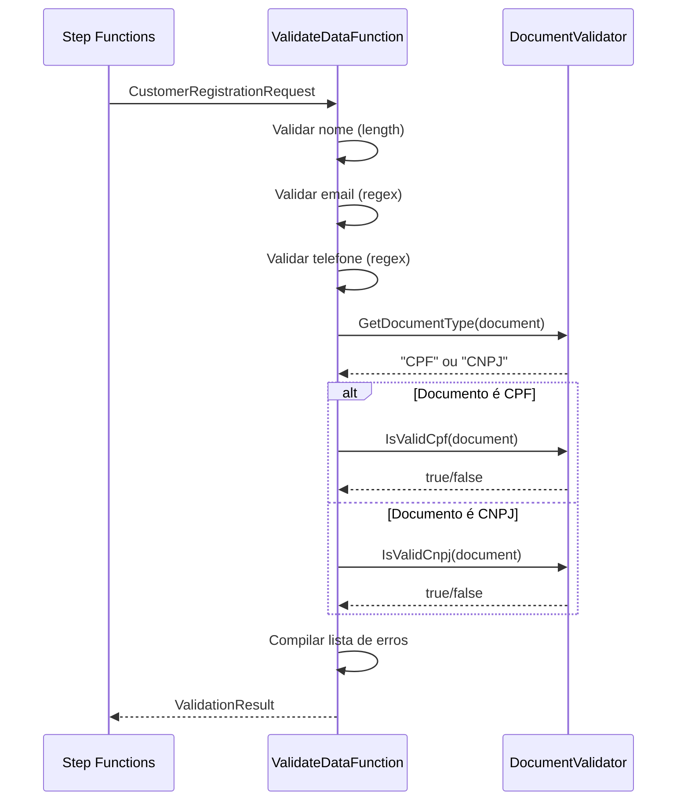
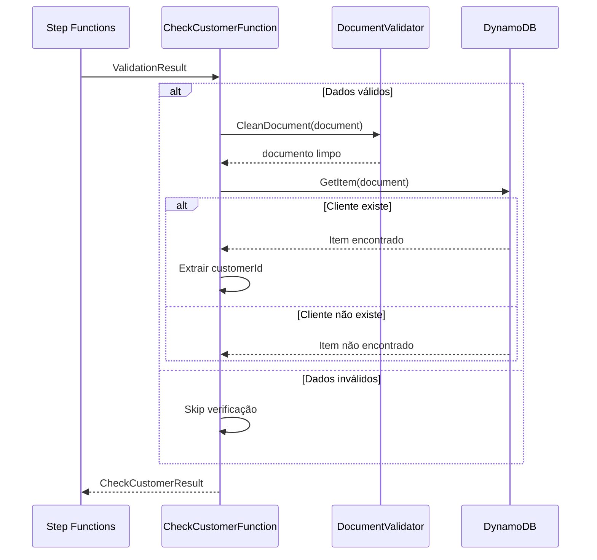
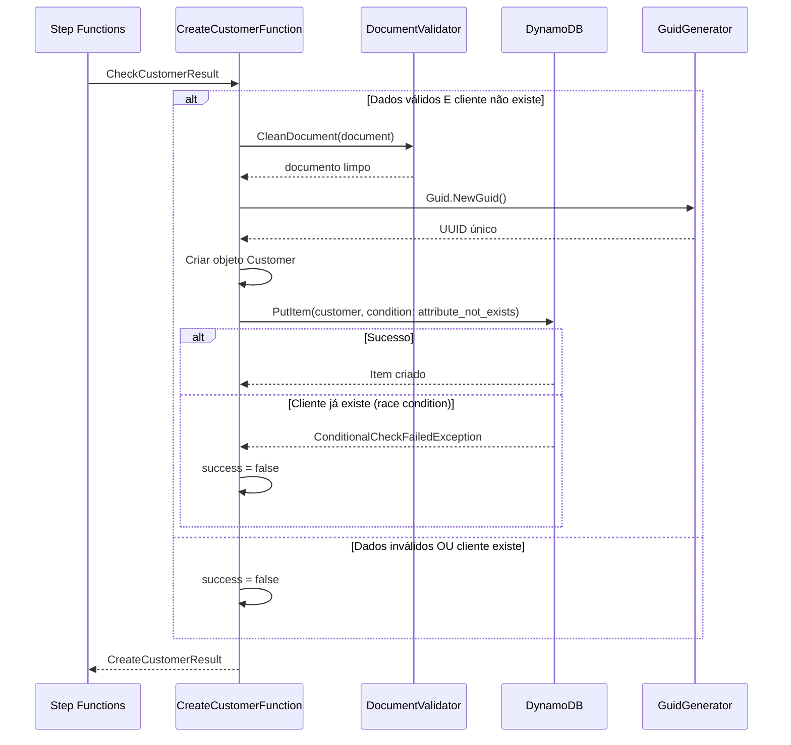
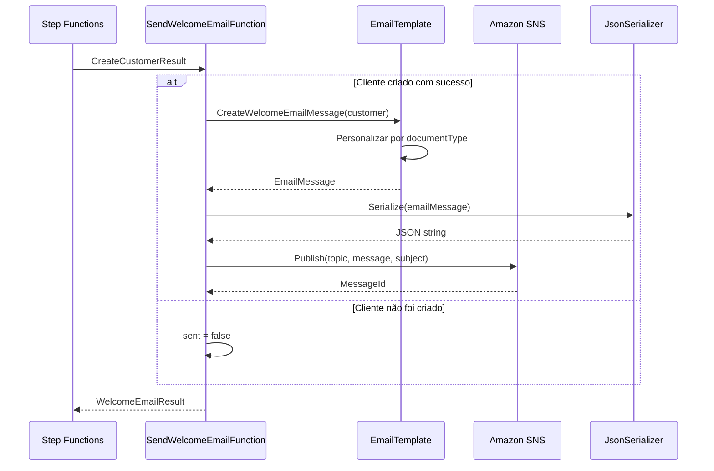
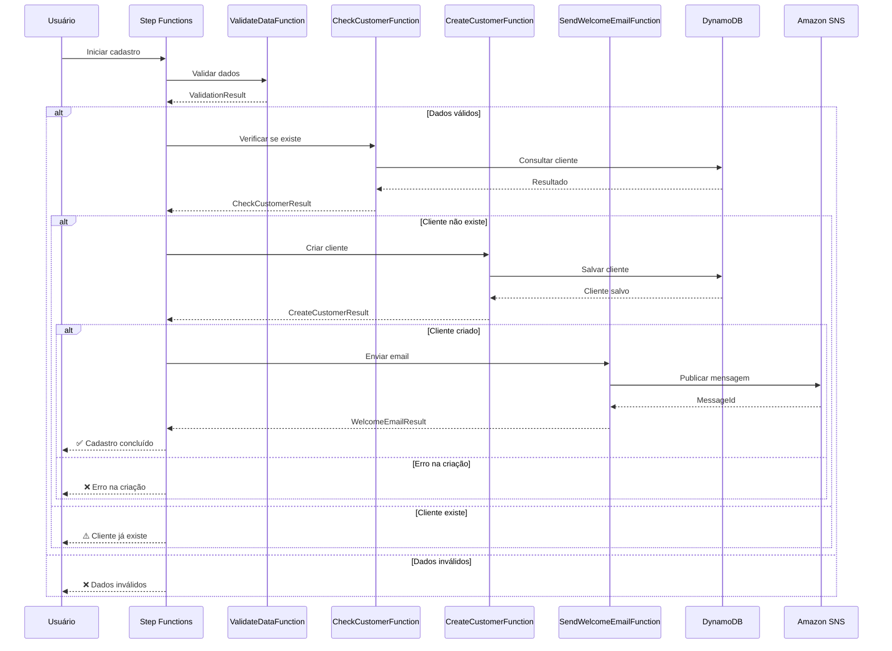

# Funções Lambda - Documentação Detalhada

Este documento explica cada função Lambda do projeto, sua responsabilidade e fluxo de execução.

## Visão Geral do Fluxo

O projeto implementa um workflow de cadastro de cliente com 4 funções Lambda orquestradas pelo AWS Step Functions:

1. **ValidateDataFunction** - Validação dos dados de entrada
2. **CheckCustomerFunction** - Verificação de duplicidade no DynamoDB  
3. **CreateCustomerFunction** - Criação do cliente no DynamoDB
4. **SendWelcomeEmailFunction** - Envio de email de boas-vindas via SNS

---

## 1. ValidateDataFunction

### 📋 **Responsabilidade:**
Valida os dados de entrada do cliente antes de processá-los, incluindo validação de CPF/CNPJ brasileiro, email e telefone.

### 📥 **Entrada:**
```json
{
  "name": "João Silva",
  "email": "joao.silva@email.com",
  "document": "123.456.789-09",
  "phone": "(11) 99999-9999"
}
```

### 📤 **Saída:**
```json
{
  "isValid": true,
  "errors": [],
  "customerData": {
    "name": "João Silva",
    "email": "joao.silva@email.com",
    "document": "123.456.789-09",
    "phone": "(11) 99999-9999"
  },
  "documentType": "CPF"
}
```

### 🔍 **Validações Realizadas:**
- **Nome**: Mínimo 2 caracteres, máximo 100 caracteres
- **Email**: Formato válido usando regex
- **Telefone**: Formatos brasileiros aceitos
- **Documento**: Validação matemática de CPF/CNPJ usando algoritmo oficial

### 📊 **Diagrama de Sequência:**



### ⚡ **Performance:**
- **Cold Start**: ~2-3 segundos
- **Warm**: ~100-200ms
- **Timeout**: 30 segundos

---

## 2. CheckCustomerFunction

### 📋 **Responsabilidade:**
Verifica se o cliente já existe no DynamoDB usando o documento (CPF/CNPJ) como chave única.

### 📥 **Entrada:**
```json
{
  "isValid": true,
  "errors": [],
  "customerData": { ... },
  "documentType": "CPF"
}
```

### 📤 **Saída:**
```json
{
  "exists": false,
  "customerId": null,
  "validationResult": { ... }
}
```

### 🔍 **Lógica de Negócio:**
- Se dados inválidos → Skip verificação
- Limpa documento (remove formatação)
- Consulta DynamoDB usando documento como chave
- Retorna se cliente existe e seu ID (se existir)

### 📊 **Diagrama de Sequência:**



### ⚡ **Performance:**
- **Cold Start**: ~3-4 segundos  
- **Warm**: ~200-300ms
- **Timeout**: 30 segundos

---

## 3. CreateCustomerFunction

### 📋 **Responsabilidade:**
Cria um novo cliente no DynamoDB se ele não existir, gerando um ID único e armazenando todos os dados.

### 📥 **Entrada:**
```json
{
  "exists": false,
  "customerId": null,
  "validationResult": { ... }
}
```

### 📤 **Saída:**
```json
{
  "success": true,
  "customerId": "uuid-gerado",
  "customer": {
    "id": "uuid-gerado",
    "name": "João Silva",
    "email": "joao.silva@email.com",
    "document": "12345678909",
    "documentType": "CPF",
    "phone": "(11) 99999-9999",
    "createdAt": "2024-01-15T10:30:00.000Z",
    "status": "ACTIVE"
  },
  "checkResult": { ... }
}
```

### 🔍 **Lógica de Negócio:**
- Se dados inválidos ou cliente existe → Retorna erro
- Gera UUID único para o cliente
- Cria objeto Customer completo
- Usa `ConditionExpression` para evitar sobrescrever
- Trata condições de corrida (ConditionalCheckFailedException)

### 📊 **Diagrama de Sequência:**



### ⚡ **Performance:**
- **Cold Start**: ~3-4 segundos
- **Warm**: ~300-500ms  
- **Timeout**: 30 segundos

---

## 4. SendWelcomeEmailFunction

### 📋 **Responsabilidade:**
Envia email de boas-vindas via Amazon SNS após o cliente ser criado com sucesso.

### 📥 **Entrada:**
```json
{
  "success": true,
  "customerId": "uuid",
  "customer": { ... },
  "checkResult": { ... }
}
```

### 📤 **Saída:**
```json
{
  "sent": true,
  "messageId": "sns-message-id",
  "createResult": { ... }
}
```

### 🔍 **Lógica de Negócio:**
- Se cliente não foi criado → Skip envio
- Cria mensagem de email personalizada baseada no tipo de documento
- Publica mensagem no tópico SNS
- Retorna ID da mensagem para rastreamento

### 📊 **Diagrama de Sequência:**



### 📧 **Template do Email:**
```
Olá, João Silva!

Seja muito bem-vindo(a) à nossa plataforma!

Seu cadastro foi realizado com sucesso com os seguintes dados:
- Nome: João Silva
- Email: joao.silva@email.com
- Telefone: (11) 99999-9999
- Documento: 12345678909 (CPF)
- ID do Cliente: uuid-gerado
- Data de Cadastro: 15/01/2024 10:30:00

Agradecemos por escolher nossos serviços!

Atenciosamente,
Equipe de Cadastro
```

### ⚡ **Performance:**
- **Cold Start**: ~2-3 segundos
- **Warm**: ~200-300ms
- **Timeout**: 30 segundos

---

## 🔄 **Fluxo Completo - Diagrama de Sequência Integrado**



---

## 🛠️ **Configurações das Funções**

### Variáveis de Ambiente

#### ValidateDataFunction
- Não possui variáveis de ambiente específicas

#### CheckCustomerFunction
- `LOCALSTACK_ENDPOINT`: http://localhost:4566
- `CUSTOMERS_TABLE`: customers

#### CreateCustomerFunction  
- `LOCALSTACK_ENDPOINT`: http://localhost:4566
- `CUSTOMERS_TABLE`: customers

#### SendWelcomeEmailFunction
- `LOCALSTACK_ENDPOINT`: http://localhost:4566  
- `WELCOME_EMAIL_TOPIC_ARN`: arn:aws:sns:us-east-1:000000000000:welcome-email

### Configurações Comuns
- **Runtime**: dotnet8
- **Timeout**: 30 segundos
- **Memory**: 128 MB (padrão)
- **Architecture**: x86_64

---

## 🎯 **Boas Práticas Implementadas**

### ✅ **Tratamento de Erros**
- Cada função tem try/catch adequado
- Logs estruturados com contexto
- Retorno consistente de erro

### ✅ **Performance**
- Validações fail-fast
- Reutilização de objetos AWS SDK
- Configuração otimizada do DynamoDB client

### ✅ **Segurança**
- Validação rigorosa de entrada
- Condições no DynamoDB para evitar race conditions
- Limpeza de dados sensíveis nos logs

### ✅ **Observabilidade**
- Logs detalhados em cada etapa
- IDs de correlação passados entre funções
- Métricas implícitas do Lambda

### ✅ **Escalabilidade**
- Funções stateless
- Uso de managed services (DynamoDB, SNS)
- Retry policies no Step Functions
