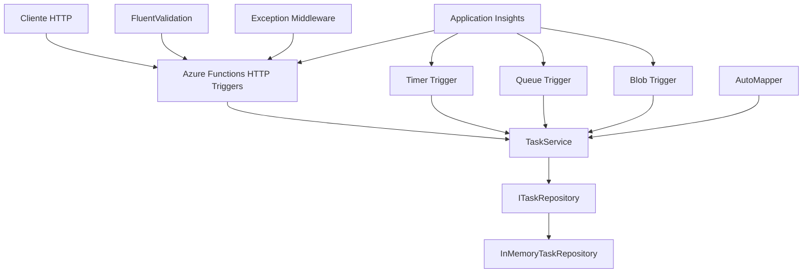
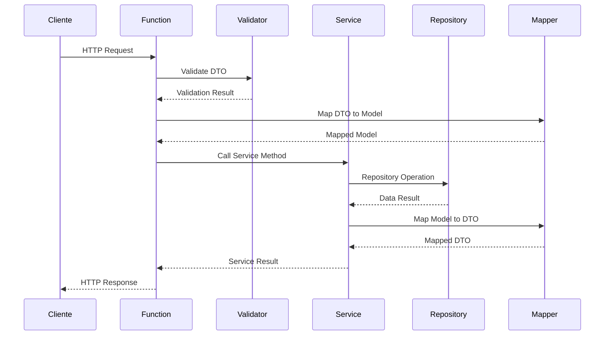

# Sistema de Gestão de Tarefas - Azure Functions .NET 8

Um sistema completo de gestão de tarefas implementado com Azure Functions usando .NET 8 e Isolated Worker Model, demonstrando arquitetura limpa, padrões de design e boas práticas de desenvolvimento.

## Arquitetura

O projeto implementa uma arquitetura limpa com separação de responsabilidades:

```
TaskManagement.Functions/
├── Functions/          # Azure Functions (HTTP, Timer, Queue, Blob triggers)
├── Models/            # Modelos de dados e DTOs
├── Services/          # Lógica de negócio
├── Repositories/      # Padrão Repository para acesso a dados
├── Interfaces/        # Contratos e abstrações
├── Validators/        # Validações com FluentValidation
├── Mapping/           # Perfis do AutoMapper
├── Middleware/        # Middleware customizado
└── Tests/             # Testes unitários e de integração
```

## Funcionalidades

### Azure Functions Implementadas

#### HTTP Triggers (API REST)
- `GET /api/tasks` - Listar todas as tarefas
- `GET /api/tasks/{id}` - Obter tarefa específica
- `POST /api/tasks` - Criar nova tarefa
- `PUT /api/tasks/{id}` - Atualizar tarefa
- `DELETE /api/tasks/{id}` - Remover tarefa
- `GET /api/tasks/status/{status}` - Filtrar por status

#### Timer Triggers
- `TimerCleanupFunction` - Limpeza automática de tarefas antigas (diariamente às 02:00 UTC)
- `DailyTaskSummary` - Relatório diário de tarefas (diariamente às 08:00 UTC)

#### Queue Triggers
- `ProcessTaskFunction` - Processamento de mensagens da fila de tarefas

#### Blob Triggers
- `ProcessTaskAttachmentFunction` - Processamento de anexos de tarefas

### Modelo de Dados

```csharp
public class TaskModel
{
    public string Id { get; set; }
    public string Title { get; set; }
    public string Description { get; set; }
    public TaskStatus Status { get; set; }
    public DateTime CreatedAt { get; set; }
    public DateTime? CompletedAt { get; set; }
    public string AssignedTo { get; set; }
    public List<string> Tags { get; set; }
}

public enum TaskStatus
{
    Pending,
    InProgress,
    Completed,
    Cancelled
}
```

## Pré-requisitos

- [.NET 8 SDK](https://dotnet.microsoft.com/download/dotnet/8.0)
- [Azure Functions Core Tools v4](https://docs.microsoft.com/azure/azure-functions/functions-run-local)
- [Azure Storage Emulator](https://docs.microsoft.com/azure/storage/common/storage-use-emulator) ou [Azurite](https://github.com/Azure/Azurite)

## Configuração do Ambiente

### 1. Clone o repositório
```bash
git clone <repository-url>
cd exemplo2
```

### 2. Instale as dependências
```bash
dotnet restore
```

### 3. Configure o armazenamento local
```bash
# Instalar Azurite globalmente
npm install -g azurite

# Iniciar Azurite
azurite --silent --location c:\\azurite --debug c:\\azurite\\debug.log
```

### 4. Configure o Application Insights (opcional)
Edite o arquivo `local.settings.json` e adicione sua connection string:
```json
{
  "Values": {
    "APPLICATIONINSIGHTS_CONNECTION_STRING": "sua-connection-string-aqui"
  }
}
```

### 5. Configure a licença do AutoMapper (opcional)
O projeto usa o AutoMapper 15, que passou a exigir uma chave de licença. Existe uma licença
Community gratuita (veja as condições em https://automapper.io). Sem a chave o projeto funciona
normalmente, mas o AutoMapper registra um aviso no log. Para informar a chave, adicione ao
`local.settings.json`:
```json
{
  "Values": {
    "AutoMapper__LicenseKey": "sua-chave-aqui"
  }
}
```

## Executando o Projeto

### Desenvolvimento Local
```bash
func start --port 7071
```

A API estará disponível em: `http://localhost:7071`

### Executando Testes
```bash
# Todos os testes
dotnet test

# Apenas testes unitários
dotnet test --filter "Category=Unit"

# Apenas testes de integração
dotnet test --filter "Category=Integration"

# Com cobertura de código
dotnet test --collect:"XPlat Code Coverage"
```

## Documentação da API

### Endpoints Disponíveis

#### Listar todas as tarefas
```http
GET /api/tasks
```

#### Obter tarefa por ID
```http
GET /api/tasks/{id}
```

#### Criar nova tarefa
```http
POST /api/tasks
Content-Type: application/json

{
  "title": "Nova Tarefa",
  "description": "Descrição da tarefa",
  "assignedTo": "usuario@exemplo.com",
  "tags": ["urgente", "projeto-x"]
}
```

#### Atualizar tarefa
```http
PUT /api/tasks/{id}
Content-Type: application/json

{
  "title": "Título Atualizado",
  "status": "InProgress"
}
```

#### Deletar tarefa
```http
DELETE /api/tasks/{id}
```

#### Filtrar por status
```http
GET /api/tasks/status/{status}
```

Statuses válidos: `Pending`, `InProgress`, `Completed`, `Cancelled`

### Estrutura de Resposta

Todas as respostas seguem o padrão:

```json
{
  "success": true,
  "message": "Operação realizada com sucesso",
  "data": { /* dados da resposta */ },
  "errors": []
}
```

## Testando a API

Use o arquivo `requests.http` incluído no projeto para testar todos os endpoints:

```bash
# No VS Code com extensão REST Client
# Abra o arquivo requests.http e execute as requisições
```

## Configurações Avançadas

### Variables de Ambiente

| Variável | Descrição | Valor Padrão |
|----------|-----------|--------------|
| `AzureWebJobsStorage` | Connection string do Azure Storage | `UseDevelopmentStorage=true` |
| `FUNCTIONS_WORKER_RUNTIME` | Runtime das functions | `dotnet-isolated` |
| `APPLICATIONINSIGHTS_CONNECTION_STRING` | Application Insights | (vazio) |
| `TaskQueue` | Nome da fila de processamento | `task-processing-queue` |
| `TaskAttachmentsContainer` | Container de anexos | `task-attachments` |

### Middleware e Funcionalidades

- **Tratamento Global de Exceções**: Captura e trata erros automaticamente
- **Validação Automática**: FluentValidation integrado
- **Logging Estruturado**: Serilog com Application Insights
- **AutoMapper**: Mapeamento automático entre DTOs e Models
- **CORS**: Configurado para desenvolvimento
- **Rate Limiting**: Configurado no host.json

## Diagramas de Arquitetura

### Arquitetura Geral


### Fluxo de Dados


## Deploy

### Azure Functions

1. **Criar Function App no Azure:**
```bash
az functionapp create \
  --resource-group myResourceGroup \
  --consumption-plan-location westeurope \
  --runtime dotnet-isolated \
  --functions-version 4 \
  --name myTaskManagementApp \
  --storage-account mystorageaccount
```

2. **Deploy via Azure CLI:**
```bash
func azure functionapp publish myTaskManagementApp
```

### Configuração de Secrets no GitHub

Para o CI/CD funcionar corretamente, configure os seguintes secrets no GitHub:

**Para Produção (branch main):**
- `AZUREAPPSERVICE_CLIENTID`
- `AZUREAPPSERVICE_TENANTID` 
- `AZUREAPPSERVICE_SUBSCRIPTIONID`

**Para Desenvolvimento (branch develop):**
- `AZUREAPPSERVICE_CLIENTID_DEV`
- `AZUREAPPSERVICE_TENANTID_DEV`
- `AZUREAPPSERVICE_SUBSCRIPTIONID_DEV`

### Configurações de Produção

Adicione as seguintes configurações na Function App:

```json
{
  "APPLICATIONINSIGHTS_CONNECTION_STRING": "sua-connection-string",
  "AzureWebJobsStorage": "sua-storage-connection-string",
  "TaskQueue": "task-processing-queue",
  "TaskAttachmentsContainer": "task-attachments"
}
```

## Contribuição

1. Fork o projeto
2. Crie uma branch para sua feature (`git checkout -b feature/AmazingFeature`)
3. Commit suas mudanças (`git commit -m 'Add some AmazingFeature'`)
4. Push para a branch (`git push origin feature/AmazingFeature`)
5. Abra um Pull Request

## Licença

Este projeto está sob a licença MIT. Veja o arquivo `LICENSE` para mais detalhes.